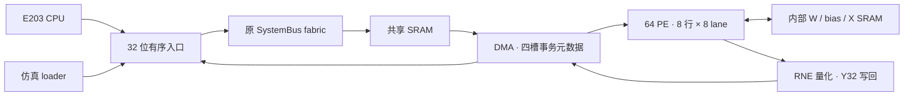

# ChipContest · E203 线性层加速器

基于 E203 RISC-V SoC 的 **64 PE、INT16 输入/权重、Y32 输出**线性层加速器。项目在原 32 位 SystemBus 上实现有序事务流水，配合 DMA、共享权重和片上 SRAM，完成 FFN1 矩阵运算：

```text
X[99,64] × W[64,256] + bias[256] → Y32[99,256]
```

一个 task 对应一组独立输入和参数，共验证 12 个 task。`main` 当前选择 **1064 修复候选**，源码与最终映射身份由 [submission/candidate.json](submission/candidate.json) 固定；此前 S2e 等版本收录在[历史导航](docs/history/README.md)。

## 当前结果

| 指标 | 结果 | 口径与证据 |
|---|---:|---|
| 12 task 总周期 | **1,691,172 cycles** | 平均 140,931 cycles/task |
| 条件吞吐 | **1064.35 task/s** | 按假定 150 MHz 换算；同口径 504.39 基线的 2.11 倍 |
| 整数输出一致性 | **304,128 / 304,128 PASS** | 12 task 全部 Y32 与独立整数参考逐位一致 |
| 最终数值时序 / 电气违例 | **0 / 0** | 原约束、原库下完整 STA；仍有 **4 项 unknown、29,332 项 untested** |
| 全 SoC 标准单元面积 | **357,030.3072** | 原库面积单位 |
| 标准单元＋内部 33 SRAM 保守上界 | **658,931.612862** | 加速器保守计费：全 SoC 标准单元＋内部 SRAM；内部 SRAM 项为 301,901.305662 |
| 保留的实际 SRAM 宏 | **353** | 内部 33＋共享 256＋CPU 64 |

吞吐来自 **RTL 仿真**，计时包含物理 clear、全部输入/参数装载、控制、DMA 计算及结果写回；暖机、poison 和任务后的参考读回在计时窗外。加载源为原 SystemBus 三源测试 loader。最终时序修复是 **mapped ECO**，没有改变这次性能测量的 RTL，周期复用已完成的 12 task 实测。

保守面积上界把全 SoC 标准单元计入加速器，不代表含全部 353 宏的整机总面积。这些面积值不能直接写为官方 mm²；条件吞吐也不等于已证明的硅上 150 MHz 或生产 GPIO 加载吞吐。当前尚未完成完整异步与物理签核；四项 unknown 的新诊断与数字回归见[跟进记录](docs/s3-y32-ingress-perf-unknown4-followup-20261114.md)。结果与限制见[最终修复报告](docs/s3-y32-ingress-perf-postfreeze-repair-20261114.md)，周期原件见[性能收据](docs/validation/s3-y32-ingress-perf-native-20261113/timing-final/performance-result.json)。

## 设计要点



- **利用原互连的流水能力。** 入口 owner FIFO 从 1 项扩为 4 项，仅保存请求来源；DMA 用四槽 kind/index 队列跟踪退休。保留原 CPU/LSU/BIU、32 位 fabric 及其缓冲参数。1000 笔饱和探针接收跨度由 3997 降为 1997 cycles，响应退休跨度由 4000 降为 2002 cycles。
- **共享数据，保持输出完整。** 8 个 dot-product engine 并行处理多行，共享 W/bias；X 双 set 和两槽结果 FIFO 支持流水。W 每个 32 位 word 装两个 INT16，X 每个 32 位 slot 放一个 INT16，bias40 占一个 64 位 slot，Y32 完整写回。
- **固定整数数值契约。** X/W 为 signed16，bias 为 signed40；当前 ACC、engine result 和 FIFO 为 41 位，覆盖固定 64 项点积与 bias 的可达范围，公共 raw48 由符号扩展得到。DMA 以 ties-to-even 右移 9 位生成 signed32 Y，输出实值尺度为 2⁻¹⁸。
- **保留实际事务与清零验收。** 每 task 观察 33,536 次物理 16 位清零写，实际并行需 1028 cycles；检查全部源写入、响应退休、Y32 写回、错误排空及 DONE 条件。完整性能提升同时包含连续 loader 的收益。

## 获取与快速复核

```sh
git clone --branch main --recurse-submodules https://github.com/mxHanks/ChipContest.git
cd ChipContest
git submodule update --init --recursive

# Python 3.10+ 标准库：核对最终原件、哈希、STA 汇总和固定 RTL 身份
python3 -B tools/current.py verify --submodule

# Icarus Verilog：双源/三源入口与原 fabric 流水回归
python3 -B tools/current.py ingress

# 从仓库已有证据包恢复同一组 12 task 向量，无需音频或 TensorFlow
python3 -B tools/current.py vectors --out build/1064/vectors
python3 -B tools/current.py check-vectors --vectors build/1064/vectors
```

完整 RTL 性能复现另需 Verilator 5+、GNU C++20/Make、RISC-V bare-metal GCC/binutils：

```sh
python3 -B tools/current.py cpu --vectors build/1064/vectors --out build/1064/full12 --tasks 12 --jobs 2
```

此命令固定使用当前候选与连续 loader，并执行 warmup。单任务检查可改为 `--tasks 1` 并选择新的输出目录；所有输出目录必须不存在。以本次生成的 `result.json` 和完整日志为准，保留实际工具链身份。依赖、预期结果与操作说明见[快速开始](quickstart.md)。

## 源码与交付地图

| 入口 | 内容 |
|---|---|
| [submission/](submission/README.md) | 当前候选 manifest、最终映射提取、结果及验收范围 |
| [tools/current.py](tools/current.py) | 统一校验、向量恢复、入口回归、RTL 任务及网表提取入口 |
| [E203 RTL 子模块](third-party/e203_hbirdv2/) | 实际生产 SoC、64 PE 核心、DMA 和 32 位入口 |
| [当前验证实现](experiments/s3-y32-ingress-perf/README.md) | 固件、测试台、性能测量与 ECO 工具 |
| [model/](model/) / [tests/](tests/) | 独立整数参考、数值契约与回归 |
| [src/main/scala/](src/main/scala/) | Chisel 源码；当前实际生成 RTL 以固定子模块为准 |
| [docs/](docs/README.md) | 当前技术报告、验收证据及历史索引 |
| [HANDOFF.md](HANDOFF.md) | 工程接手、固定身份与待闭合事项 |

历史实验及证据保留既有路径，避免破坏 SHA 清单和工具依赖；本地产物统一输出到忽略入库的 `build/`。不要用旧 S2e 默认脚本或历史 64 位端点候选替代本页命令。

## 最终映射与验收范围

```sh
python3 -B tools/current.py unpack-mapped --out build/1064/final-mapped
```

提取前核对最终包及其 80 份 payload，输出 `apply/mapped.v`、DC 导出的 `apply/mapped.sdc` 和保留祖先层级的 8 份 SVF。最终网表 SHA256 为 `d83acb49caec51aabc66d8ad61b8784294bebe26c5458aa0b095f9d12a2ae0d1`。原生 DC 回放、完整 PT STA、面积及严格 mapped→mapped 结构一致性证据见[最终证据目录](docs/validation/s3-y32-ingress-perf-native-20261114/catch3/)。

严格结构证明保留 353 SRAM，并验证身份 BUF 收缩后的完整连接分区。它不替代 RTL→mapped FM。4 项 unknown 涉及 AON 去毛刺首级 setup 与 PMU recovery；异步输入/释放的 CDC/RDC 合同、复位脉宽、亚稳态、CTS/SPEF/布局后多角、带门延迟任务仿真、功耗、生产加载与官方 600 样本资格仍待验收。

工艺库、工具许可证及最终 DDC 未发布。现有 EDA 工具保留原生实验链依赖；从空 `build/` 重新综合 RTL 不能一步得到最终 ECO 网表。普通克隆可离线核对已发布原件，并直接取得同一最终映射供有许可环境审阅。
