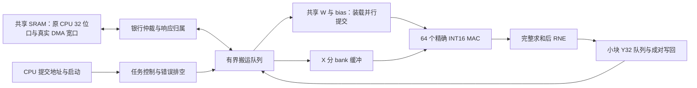

# 4,000 task/s 高并行优化计划与可行性评估

2026-11-10，Asia/Shanghai。本文静态评估完成时尚未新增 RTL 实现、仿真、综合或 STA。用户随后独立授权新一轮实验：**今天 2026-11-10 23:59 上海时间之前完成一轮**；不是延长 11 月 9 日旧单日实验。现有已发布联调版本保留为回退，实际实验进度见 Goal 执行记录。

正式 Goal 已实际创建，阶段状态、验收、分工、时间及停止规则见 [Goal 执行合同](s3-y32-4k-goal.md)。本文作为技术方案，不将计划或预算通过当作实现完成。

**用户已确认本轮以比赛的 2.25 mm² 为面积上限，允许超过此前 1.25 倍预算。主路线确定为 8 行×8 列共 64 PE＋真实 64 位搬运＋共享 W/bias；4 行×16 列作为备选。周期预算上有实现 4k 的空间，主要先验证真实带宽、重叠调度和 150 MHz 时序。面积仍须按官方计费范围、核实物理单位后实测，不能现在宣称通过。原 32 位单共享口下，4k 仍不可达。**

## 1. 冻结比较口径

- 基准父提交 `655713b304597ca5b2810a0940ac3f1850072d63`、子提交 `45e61b6101ad6f0aaa7583098294ffb1550f1f2d`。软件 ABI 见 [联调 handoff](s3-y32-hw-sw-handoff.md)。
- 每任务 `X[99][64] × W[64][256] + bias[256]`，共 **1,622,016 MAC、25,344 个 Y32**；X/W signed16、bias signed40、既有最终 RNE 语义不变。
- 每任务独立参数、完整真实清零、全部输出写回与写响应退休。不得用参数驻留、少算输出、低精度乘法或改变计时边界凑吞吐。
- 当前完整 12 任务 **1,514,236 拍**，按假定 150 MHz 换算 **1,188.72 task/s**；含 gap 为 1,514,728 拍、1,188.33 task/s。全部 304,128 个输出逐位一致。**该发布版本尚未取得完整时序通过和新面积结果。**
- 4k = **37,500 拍/任务、12 任务主周期 ≤450,000 拍**，需要全窗口平均 43.25376 个有效 MAC/拍。gap 仍单列，同时报告含 gap 结果。
- **现行面积上限：2.25 mm²**，按用户对本轮 4k 方案的明确选择执行；此前 1.25 倍／328,309.34679750 库面积单位不再作为本轮淘汰门槛，仅保留历史比较。新增加速器逻辑、内部 W/bias SRAM、缓冲、宽接入口和仲裁等按赛题计费范围完整核算，不以复用 CPU/共享存储本体稀释费用；接口改造费用不能漏计。
- 库面积单位尚未权威确认为 µm²，SRAM 最终计价也需匹配赛方规定。因此暂不直接把 2.25 mm² 写成 2,250,000 库单位的签核门槛，先补齐单位和计费合同。

## 2. 三项硬门槛

### 算力：至少超过 43 个完整 MAC/拍，64 PE 是合理起点

下表只算连续 K=64 的 MAC 和 99 行尾 tile，不含搬运、清零、INIT、捕获、退休和控制。

| 阵列：行×列 | PE | 纯 MAC 拍/任务 | 纯计算吞吐上限 | 评价 |
| --- | ---: | ---: | ---: | --- |
| 2×8，现方案 | 16 | 102,400 | 1,465 task/s | 不具备 4k 算力 |
| 4×8 | 32 | 51,200 | 2,930 task/s | 可作中间对照，不能作为 4k 终点 |
| 5×8 | 40 | 40,960 | 3,662 task/s | 纯计算已超预算 |
| 6×8 | 48 | 34,816 | 4,308 task/s | 留给全部其他工作仅 2,684 拍，现独立装载阶段不满足 |
| 8×8 | 64 | **26,624** | 5,634 task/s | W 读口复用好，X 存储较大 |
| 4×16 | 64 | **25,600** | 5,859 task/s | 尾行浪费少、X 更小，W 读口及布局要重做 |

公式：`ceil(99/R) × ceil(256/C) × 64`。64 PE 达到 4k 需要全窗口有效利用率约 **67.6%**，不代表考虑清零/装载后计算窗口只需此利用率。

### 带宽：原通道即使计算免费也到不了 4k

现每任务 W 8,192 字＋bias 512 字＋X 6,336 字＋Y 25,344 字＝**40,384 个 32 位事务**。目标每任务只有 37,500 拍，而原端点最多每拍接收一笔。理想带宽上限仅 **3,714 task/s**，加现有 2,052 拍真实 clear 后最多 **3,535 task/s**；实际端点还有每七拍一次停顿。

X 当前每个 32 位槽只放一个 INT16。改 packed16 后总量可降至 37,216 字，但即便假设无停顿、clear 优化到约 1,028 拍，也至多 **3,922 task/s**，尚未计其他开销。因此 **X 打包、深 FIFO、多在途和多 master 最终串行到同一个旧端点，均不能单独解决 4k**。

需要真正每拍同时服务两个 32 位字的接入口，例如 64 位物理银行访问，或等效独立银行并发；新增接口必须经过实际受测共享存储和仲裁。原 CPU 32 位访问保持兼容，CPU/LSU/BIU 控制及在途配置不改，存储容量不增加。若正式平台不允许该接入口扩展，应停止这条 4k 支线并明确记录边界内不可达。

### 面积：新上限允许优先复用结构，最终仍须完整实测

根据旧同库 native leaf inventory，16 个 PE 阵列面积合计 32,299.2096，四个寄存器 X 行缓冲合计 34,096.944。按旧映射复制 PE 阵列，新增 48 PE **估算新增约 96,898**；它超过旧 25% 增量预算，但新上限下不再据此淘汰。

复制成 8×8 并保留当前形式的 X 双缓冲，条件面积估算约 **478,824（+82.3%）**，还未计扩大的结果 FIFO、新接口及额外时钟缓冲。这是旧映射的复制模型，**不是新综合值，也不是所有紧凑实现的数学下界**。

**若上述库单位确认为 µm²**，478,823.762238 对应约 **0.479 mm²**，占 2.25 mm² 的约 **21.3%**，算术余量约 1.771 mm²。这仅说明条件模型下有较大预算空间：复制模型尚未完整计入新 FIFO、宽接口/仲裁及额外时钟缓冲，也不是已发布修复版或 64 PE 的新综合结果。不得据此宣称面积验收通过。

新顺序是先复用已验证 48 位数值路径、X 双缓冲与小块结果退休，避免把紧凑 MAC、41 位累加和新存储结构同时作为首版变量。待完整功能/周期结果选型后集中做一次同库面积与 STA；若实测逼近 2.25 mm²，再按实际面积分解优化 X、重复结果寄存器和精确算术。面积与时序都不能借用旧基准冒充新方案实测。

## 3. 主方案与备选

| 项目 | 主方案：8×8 共 64 PE | 备选：4×16 共 64 PE |
| --- | --- | --- |
| 选择顺序 | **当前主路线，优先复用已验证模块** | 主方案在 X/广播/时序或完整周期上不足时再对照 |
| W 数据流 | 沿用八个逻辑读 bank，八个 W 广播到八行 | 十六颗现有 W 宏重排成十六个读 bank，需改布局和 bias 预取 |
| X 双缓冲 | **2 KiB**，八行并发读取 | **1 KiB**，四行并发读取 |
| W/bias | W 16 宏＋bias 1 宏保持一套，容量不变 | 同左，禁止靠复制参数 SRAM 取得带宽 |
| 数值与结果 | 先保留 48 位累加、两槽 raw48 FIFO 768 B，小块退休和 Y32 成对写回；另计快照/元数据 | 同样保持精确语义及有界结果所有权 |
| 搬运 | 真实 64 位接入口或等效银行并发；队列按测量配置 | 同左 |
| 采用条件 | 完整周期、2.25 mm² 计费面积与 150 MHz 时序均通过 | 只有同条件结果优于主方案才切换 |

8×8 使八个 W 广播给八行，可沿用八个逻辑 bank、十六颗宏，W 地址仍为 `floor(c/8)*64+k`。4×16 将十六颗现有宏重排成十六个独立 bank，地址 `floor(c/16)*64+k`，不增容量，但需更新 W 分发、读选择和十六列 bias 预取。二者纯计算相差 1,024 拍；8×8 读取的 16 位 W 字总量较少，4×16 的 X 存储和尾行成本更低，不能只按纯 MAC 拍选型。

若采用 41 位内部累加，必须复用完整 signed16、signed40、K≤64 任意前缀的既有证明，并验证新流水结构。最终 RNE 仍发生在完整求和之后。INT16 打包搬运是无损的；普通乘法器拼接不能未经证明当作两路精确 INT16 MAC。

## 4. 搬运与调度方案

64 位接口先保留旧 X 软件布局，减少联调变量：每 beat 四个 W INT16、一个 bias 的 64 位槽、两个原 X 槽或两个 Y32。每任务 **20,192 个 64 位 beat**。后续独立开启 packed-X，四个 X/beat，进一步降至 **18,608 beat**。X 打包需要能力位/格式字段及对应物理写端口，不能让软件悄悄改变旧格式。

W/bias 装载共 4,352 个宽 beat。**不能把原约 12,695 拍直接除二**：原 bias 三次 16 位落库和状态等待仍在，直接加宽且继续先 W 后 bias，静态估算仍约 7,400 拍。计划用 1–2 项 bias 暂存，将 bias 本地提交与 W 读取/四 bank 写入重叠，争取全部物理提交完成 ≤6,000 拍。

初始不增加通用 DMA/ROB。保留最小有界队列；只有真实响应延迟、队列占用或 bank 冲突显示单在途不足时，才对照 1/4/8 深度。当前一拍响应端点已允许同拍退休与接受，多在途本身不是收益来源。

W 清零改为十六颗现有宏同拍写同一局部地址，目标约 1,024 拍扫完；bias、X 和所有队列/状态并行真实清零。完整 clear 预算 **≤1,100 拍**，必须从公开口制造非零前态并逐址验证；约 1,028 拍仅为候选估算。

## 5. 周期预算与继续条件

以下为 8×8 宽口候选的分配，**全部是待验证门槛**，不是预期实测。

| 不重叠的主阶段 | 预算 |
| --- | ---: |
| 完整真实 clear | ≤1,100 拍 |
| W/bias 全部物理提交 | ≤6,000 拍 |
| 首 X 请求到末 Y 写响应的 RUN | ≤29,000 拍 |
| 其他启动、阶段衔接及完成开销 | ≤1,400 拍 |
| 合计 | **≤37,500 拍** |

RUN 内纯 MAC 26,624 拍，剩 2,376 拍容纳全部组间控制、首次 X、背压及末 Y 排空。当前状态机约 68 拍/列组的静态模型已经占 28,288 拍；因此 29k 并不宽松，需要削减启动/捕获泡并验证生产突发。只有 RUN 内相互重叠的工作可按并发模型计算；clear、完整参数预装载与计算的现阶段屏障不能凭空取 max。

宽口混合服务门槛争取 **≤1.25 拍/有效 64 位 beat**。按 packed-X，RUN 内 X/Y 共 14,256 beat，需约 17,820 个服务拍；保留旧 X 格式则约 19,800 拍。它们有机会隐藏在计算窗口内，但仍须证明对每个 tile 的截止时间、X 所有权、输出突发和仲裁停顿，而非只比总量。

内部选型优先争取 **≤35,625 拍/任务**，给 4k 留约 5% 周期余量；37,500 是最终性能边界，不作为“刚好填满即可信”的保证。主口径过线后仍补报包含 gap 的总值。

## 6. 分阶段与并行分工

| 步骤 | 并行工作 | 交付与继续条件 |
| --- | --- | --- |
| P0：口径与边界冻结 | 集成负责人确认共享宽口许可、面积口径、复位/时钟合同；模型人员复核任务/流量/预算 | 保留当前 v1 回退；若宽口/银行并发不允许，明确否决 4k，不盲目写更多 PE |
| P1：结构与计费核对 | 面积人员核实物理单位、官方 SRAM 计价及新增接口范围；通道人员设计银行映射/CPU 兼容接口；验证人员建立接口合同 | 以 8×8 复用结构为主，保留 4×16 备选；原 25% 不再作为淘汰门槛。探索阶段不重复跑全 SoC 综合 |
| P2：真实通道原型 | 通道人员实现宽口、mask/对齐/仲裁/响应路由及 WB 重叠；存储人员实现物理 clear；验证人员分别施加读写错误/背压/reset | 实际共享接口混流 ≤1.25 拍/beat、完整 WB≤6k、clear≤1.1k；不达标先修通道，不扩 PE |
| P3：64 PE tile | 核心人员实现八行调度、尾行 mask、W/bias 广播和结果退休；集成负责人统一所有权接口 | 主方案精确数值与协议通过；只有测量显示不足才展开 4×16 备选，不同时维护两套生产分支 |
| P4：CPU 单任务到完整 12 任务 | 软件人员保留 fence/error/done 合同；验证人员核对清零、源参数身份、accepted/retired、每层 Y 和阶段周期 | 单任务正确且有收益才跑完整 12 任务；304,128 个 Y32 全部逐位一致，各层单列，不能用平均值掩盖超时/错误 |
| P5：集中 PPA 与发布 | 仅对最终功能/周期候选做同库综合和完整 STA；负责时序的人处理真实 setup/hold/DRC/覆盖问题 | 同一源码证明 150 MHz、按官方计费的面积 ≤2.25 mm² 和功能周期；不靠 false-path/放松约束制造通过；缺项明确标未通过 |

生产源码统一由一名集成负责人修改；通道、核心、验证可并行在独立候选目录工作。接口先冻结：请求含地址/方向/mask/槽身份，响应归属保持至退休；首次错误停止新发并排空既有请求；reset 后旧响应不能写新任务。DONE 必须等待所有输出响应退休、所有队列/所有权排空。

此前完整时序仍未闭合。P0/P1 可先做静态设计；新的性能 RTL 实现按既有要求应等待时序阶段通过，或在后续明确调整执行顺序后进入隔离探索。面积约束回复未自动重设旧截止；随后用户已明确本轮于 2026-11-10 23:59 上海时间前完成一轮实验。正式共享口边界、外部复位合同等材料缺失时，不能宣称正式资格。

## 7. 对截图的结论

截图报告最后约 4,509.65 task/s，多个版本名看起来与装载重叠、bank、结果流式退休和队列相关，**这些只是命名线索**。截图没有给出完整 RTL、任务口径、实际并行 MAC 数、参数装载/清零边界和原始日志，不能认定它以 16 个完整 INT16 MAC 实现了同口径成绩，也不能推定 Q8/Q16 指精度或队列深度。

若任务、150 MHz 与 dense 工作量均相同，该数字要求平均约 **48.76 个有效 MAC/拍**；与纯 16 PE 上限不符，必须存在更多有效计算能力、特殊算术/数据前提或不同计时口径。我们借鉴可验证的设计原则，不以截图数值作为本方案证据。

学术/开源架构上可借鉴“banked 存储＋数据复用＋load/execute/store 解耦”。例如 Gemmini 官方文档明确使用独立控制器、访问队列与双缓冲循环控制来重叠搬运和计算；本项目只引入必要的轻量控制与所有权管理，不移植其整套 ISA/ROB。[Gemmini 官方架构说明](https://github.com/ucb-bar/gemmini/blob/master/README.md#major-components)

## 8. 结果等级与证据入口

- **已完成**：基准身份复核、计算/带宽/面积静态审计、高并行方案与分阶段继续条件；按用户选择将本轮面积上限改为 2.25 mm²，主路线切换为复用型 8×8 共 64 PE＋真实 64 位通道。
- **已否决**：原 32 位单口只加 PE/FIFO；仅凭截图反推已验证实现。旧“复制方案超 1.25 倍”的计算继续保留，但不再作为本轮否决理由。
- **待验证**：主方案按官方范围计费的完整面积、库单位和 SRAM 计价、真实宽口许可与吞吐、完整调度收益、同源 150 MHz 时序和正式资格。
- **性能目标状态**：4k 尚未实现或实测；当前可信发布候选仍为 16 PE v1。

详细 [一手资料研究](s3-y32-4k-primary-research.md)、[计算/面积审计](../build/parallel4k-20261110/compute-area-audit.md)、[带宽审计](../build/parallel4k-20261110/bandwidth-audit.md)及各自机器可读 JSON 保留推导和原件 SHA。旧面积原件为 `build/server-dma-synth-20261109/native/r3-full/extracted/candidate/leaf-inventory.tsv`；新方案没有借用其结果宣称新面积通过。

## 2026-11-10 用户执行顺序更新

优先本机资源，先进行真实宽口、64 PE 和 CPU 端到端功能/周期仿真；达到瓶颈、方案定稿后集中做一次面积综合及完整 STA。本轮不启动服务器 RTL 仿真或探索综合。旧时序未闭合仍须保留为最终验收缺项，不再作为本地原型的前置阻塞。截止仍为今天23:59上海时间。

## 首轮本地瓶颈实测（R1，尚非最终12任务结论）

真实CPU单任务：含物理清零35,742拍，按假定150MHz约4,196.74task/s；gap43拍另列。W/bias阶段5,078拍，接近真实限速端点4,352×7/6≈5,077拍下限；MAC有效26,624拍占完整主口径74.49%，RUN剩余约3,011拍为调度/首尾及搬运衔接。当前保留64PE和单在途外围DMA，先冻结并验完同源R2，后续收益应从group/tile气泡评估，不再盲目加深DMA队列。错误码分类的小修复已单独记录并触发新源重测；R1不冒充R2证据。默认构建和旧32位DMA构建的四个修改模块均已预处理比较，与旧版本代码标记一致（只正规化空白和等价wire声明）。
