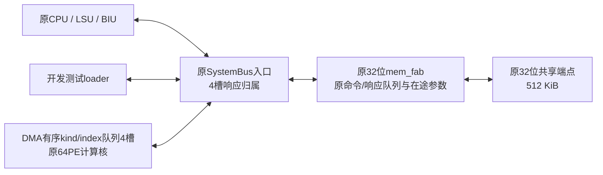

# 32位SystemBus有序事务流水优化与原生综合报告

后续同源映射 ECO 已将完整 PT 数值时序违例由 467 项降至 8 项，新增 615 个非反相缓冲，并完成 DC 回放、全新 PT 重载与 mapped 缓冲收缩证明；见[时序修复记录](s3-y32-ingress-perf-timing-repair-20261113.md)。本报告的原始映射面积/时序统计仍对应其冻结身份，后续候选单独列示。

**状态：DC、同映射PT与新增loader接口路径采集完成，原件已回传核验。PT存在467项时序违例、1973项电气规则违例及29,335项未测检查；150MHz时序尚未闭合。**

本报告对象为 **1064.35 task/s原候选**：父源码基点`1aceb3d`，RTL子提交`5470c5650f2d11d16e7c52cc96626d21030a3973`。单次task执行99×64与64×256的固定形状计算并写回99×256个Y32；本轮共验证12个独立参数任务。报告时间采用北京时间（UTC+8）。

## 1. 已取得的结果与适用范围

保持64PE、原CPU/LSU/BIU、原32位mem_fab及其队列参数不变，入口响应归属与DMA请求调度改为4槽有序流水，并使测试loader连续提交源写。12个任务计时窗口合计由3,568,690拍降至1,691,172拍，按假定150MHz换算，由504.3868提升至1064.3506 task/s，吞吐为基线的2.1102倍，周期减少52.6108%；304,128个Y32逐位一致。

该数字来自三源SystemBus测试loader开发环境，包含实际源数据写入及响应时间。测试激励的发射器在仿真环境中，真实生产入口尚未由这个结果证明。原候选仍保留结果寄存器FIFO、engine结果寄存器、bias预取slot和DMA行快照；它没有合入另一个374宏分支的存储整改。GPIO整合版的测试结果不作为本报告的1064性能或PPA证据。

<!-- NATIVE_SUMMARY_BEGIN -->
本轮原生DC于2026-11-13 **18:40:41—19:09:55**完成，8核上限，墙钟1754.145秒（约29分14秒）。返回码0、源码无漂移、原生工具错误和必需产物缺失均为零；实际枚举353颗SRAM。自己的mapped.v/ddc/sdc及非空final.svf已生成，完整字节已回传并与原生收据逐SHA/字节数核验。同map PT在独立目录完成重收，原失败采集保留；本轮未实施ECO。DC和PT均已报告违例，**综合完成不表示150MHz时序闭合，1064.3506仍为假定150MHz的周期仿真换算。**
<!-- NATIVE_SUMMARY_END -->

## 2. 架构与实现改动

数据流如下，三个源共用原fabric和共享端点：

生产RTL相对冻结基线只改变两个文件，全部168项生产RTL集合及其余字节均核验不变：

- [入口RTL](https://github.com/mxHanks/e203_hbirdv2/blob/5470c5650f2d11d16e7c52cc96626d21030a3973/rtl/e203/subsys/xu_systembus_ingress32.v#L90)：既有`u_platform_icb_arb`的响应owner FIFO由1槽改为4槽。原fabric仍为原命令/响应缓冲和单目标在途配置。
- [DMA RTL](https://github.com/mxHanks/e203_hbirdv2/blob/5470c5650f2d11d16e7c52cc96626d21030a3973/rtl/e203/perips/xu_matrix_dma_sysbus32.sv#L38)：增加4项有序kind/index队列，响应按命令接受顺序退休。该队列只保存必要事务元数据，kind共12位、index共56位、指针4位、计数3位，共75位控制状态。

实现保留W两半拼接、bias物理提交、X双set所有权、99行尾组以及Y最后响应退休后释放的契约。命令受背压时保持payload稳定；首次错误后停止新的未声明请求，已接受和已锁定声明的请求完成排空。CPU固件C/start/linker及实际加载image不变。输出仍为完整99×256 Y32，未压缩输出，也未增加共享SRAM旁路端口。

连续测试loader最多提交4笔有序源写。这属于实验调度改动，因此2.1102倍收益由入口/DMA排队和源加载连续调度共同贡献，不能全部归因于单独增加owner FIFO深度。

## 3. 计时方法与性能结果

主计时从加速器接受物理clear请求起，到最后一笔Y32写响应退休止，按包含边沿的周期计数。每任务重新加载全部X/W/bias；源写和响应、CPU控制/轮询、DMA读取、计算、写回及等待均在窗口内。先执行完整暖机，使后续clear面对非零前态；暖机不计入12个主任务。Y poison及任务结束后的验证读回位于计时窗外，两版口径相同。1,691,172拍是12个主计时窗口之和，不是把验证读回和任务间poison一并计入的连续测试campaign墙钟跨度。

| 完整12任务统计 | 冻结基线 | 优化候选 |
|---|---:|---:|
| 12个主计时窗口周期之和 | 3,568,690 | 1,691,172 |
| 平均周期/task | 297,390.8333 | 140,931 |
| 条件吞吐，task/s@假定150MHz | 504.3868 | 1064.3506 |
| 平均物理clear周期 | 1,028 | 1,028 |
| 平均源加载周期 | 126,331.0833 | 42,114 |
| 平均DMA读取/计算/写回周期 | 169,964.9167 | 97,729 |
| 平均控制间隙周期 | 66.8333 | 60 |
| 精确一致的Y32个数 | 304,128 | 304,128 |

优化后的12层均为`140931 = 1028 + 42114 + 97729 + 60`拍。完整12任务节省1,877,518拍，其中源加载减少1,010,605拍，DMA阶段减少866,831拍，控制间隙减少82拍，clear不变。

同一优化二进制采用串行loader时，单任务为189,061拍、793.3947 task/s；其源加载90,237拍，DMA97,731拍。这个单任务对照证明加载调度贡献显著，但不将单任务对照写成另一套完整12任务结果。

首DMA端点额外等待31拍时为140,968拍；首源加载端点额外等待31拍时为140,963拍。注入等待完整进入计时窗口，端点相位和控制间隙变化也按实测计入，未要求总周期机械地只增加31。

### 3000 task/s与搬运预算

每任务源写15,040笔，DMA源读15,040笔，Y写25,344笔，共55,424次共享端点数据事务；还会有CPU控制等开销。原fabric探针1000请求的接收跨度由3997降至1997拍，全部响应退休跨度由4000降至2002拍，已利用约两拍一笔的能力。

按每事务恰好两拍并加1028拍clear，乐观边界为`150000000 / (55424 × 2 + 1028) = 1340.7701 task/s`。冻结端点模型每7拍禁受理1拍，保持该背压的探针1000笔退休耗2335拍；按其稳态约7/3拍每笔估计，乐观边界为1150.7421 task/s。实测约为后者的92.49%，剩余时间包含控制/轮询和计算、结果切换间隙。

因此，在本布局、完整装载计时和服务模型下，3000 task/s对应的50,000拍预算低于当前数据搬运预算。1341与后续packed-X等理想估算不是已实现性能；本轮没有实现packed-X，也不通过删除源加载或背压来追平目标。

## 4. 功能、错误与复位验证

| 验证 | 本候选实际结果 |
|---|---|
| CPU完整12任务 | 304,128个Y32精确一致，源加载和DMA请求/响应独立守恒 |
| 单任务事务 | DMA读取15,040、Y写25,344，共40,384笔响应；原输出格式公开读回 |
| 多在途 | DMA与loader实际峰值在途3；独立入口压力测试达到4槽满，并覆盖环绕及同时入出 |
| 清零 | 每task观察到33,536次16位物理零写：W16,384、X16,384、bias有效窗768；元数据和装配状态另核验 |
| 共同复位恢复 | 三阶段取消时在途数2、3、3；换参数后76,032个Y32精确一致 |
| 七地址错误恢复 | W低/高、bias低/高、X、首Y、末Y错误后，共177,408个恢复输出一致 |
| 最后Y响应背压 | 响应已VALID后真实保持97拍，最后响应退休后完成 |
| 单行/尾组与普通背压 | 对应回归通过，99行尾组保留 |
| 检查器负例 | 漏源写、漏Y响应、5项在途、少一次物理清零均被拒绝 |

内部宏并行清零，因此33,536次物理写不等于33,536个时钟周期。bias宏末256地址未映射为任务数据，本报告不宣称它们已清零。物理零写数量也不表示CPU/shared所有存储已清零。首次CPU构建缺失SRAM adapter、初次回归连接/参数及过严在途断言等失败原件保留；最终未通过删除必要观察器获得PASS。

证据见[原性能摘要](validation/s3-y32-ingress-perf-20261113/summary.json)、[逐层周期CSV](validation/s3-y32-ingress-perf-report-20261113/per-layer-cycles.csv)、[原日志独立重核结果](validation/s3-y32-ingress-perf-report-20261113/audit-summary.json)。这证明本向量集上的RTL功能与开发性能，不替代RTL→mapped一致性或官方600样本评测。

## 5. 本轮原生综合边界与存储

旧准备包采用N2/PW1，不能表示1064实测的N3/PW2。新包启用同一RTL已有的`XU_SYSBUS_TEST_LOADER`，仅在PPA顶层暴露并直连其10个ICB端口，共71输入位、35输出位；其余158项编译源和完整159项编译顺序保留。入口、DMA、计算核与子提交5470逐字节一致，未引入storage21覆盖。

本轮PPA计入三源入口及接口逻辑。测试bench中的外部发射器不是芯片内实现的装载bridge，其完整生产部署和合法接入口不由本轮面积结果证明。

| 物理SRAM分组 | 数量 | 每颗规格 | 口径 |
|---|---:|---|---|
| ITCM | 32 | RAMSP1024X16 | 既有CPU |
| DTCM | 32 | RAMSP1024X16 | 既有CPU |
| shared | 256 | RAMSP1024X16 | 既有512KiB共享存储 |
| W | 16 | RAMSP1024X16 | 内部存储，计费 |
| bias | 1 | RAMSP1024X16 | 内部存储，计费 |
| X | 16 | RAMSP1024X16 | 内部存储，计费 |
| 合计 | 353 | — | 内部33，复用CPU/shared共320 |

CPU功能仿真使用289个功能宏模型（shared256＋内部33），CPU RAM保留行为模型；原生PPA使用物理CPU SRAM adapter补齐64颗CPU宏，合计353。`SYNTHESIS`处理、CPU物理adapter和PPA顶层是明确的模型/实现边界差异，当前尚无本轮映射一致性证明来消除这些差异。

原候选仍包含以下寄存器payload，353宏中没有result宏：

| 状态 | RTL组织 | payload位数 |
|---|---|---:|
| 核心result FIFO | 2槽×8行×8lane×41位 | 5,248 |
| engine结果寄存器 | 8engine×8lane×41位 | 2,624 |
| bias预取slot | 2槽×8lane×40位 | 640 |
| DMA Y行快照 | 8个Y32 | 256 |
| 以上小计 | 不含ACC、其他控制和装配状态 | 8,768 |

这些是源码payload位数，不能当作mapped触发器数量或面积。全部保留状态通过映射leaf计费，不能手工减去。具体源码位置见[存储清单](validation/s3-y32-ingress-perf-report-20261113/storage-inventory.csv)。它们尚未满足后续存储整改分支所针对的限制，故本报告不宣称正式存储合规。

## 6. 综合、面积与同网表STA

保持原150MHz envelope SDC、同一标准单元/SRAM库和`compile_ultra -no_autoungroup`。主HF与divider envelope均按6.666666667ns；LF为30517.578125ns，JTAG为100ns。新loader端口沿用原HF IO max0.5ns/min0ns预算；clock uncertainty、transition和gating setup/hold均保留原0.1ns。未添加false path、multicycle、异步clock group或ideal network。

用户授权多核后，本次设置`max_cores=8`并限定Linux affinity 0–7；原生host-options确认上限，执行期间观察到8线程、多核CPU活动。只运行一个自己的EDA阶段，DC完成后串行同map PT。DC生成并显式关闭刷新本轮`final.svf`，SVF、map、DDC、SDC及库身份绑定到PT。

<!-- NATIVE_RESULTS_BEGIN -->
### 6.1 DC实际结果

采用DC `T-2022.03-SP5-5`、SS `ss_v0p99_125c`库文件，返回状态为`SYNTHESIS_COMPLETE_NOT_QUALIFIED`。含面积摘要在内的26项返回成员逐SHA/字节数核验通过；见[原生DC收据](validation/s3-y32-ingress-perf-native-20261113/native-dc/execution.json)、[复核收据](validation/s3-y32-ingress-perf-native-20261113/native-dc/review.json)和[报告重算绑定](validation/s3-y32-ingress-perf-report-20261113/native-dc-for-report.json)。

| 统计对象 | 数量 | 面积，原始库单位 |
|---|---:|---:|
| 全SoC标准单元 | 147,753 | 357,030.307200 |
| 全SoC SRAM（含复用部分，仅全量枚举） | 353 | 3,229,429.118140 |
| 命名计费scope标准单元 | 87,366 | 222,396.854400 |
| 全部内部SRAM | 33 | 301,901.305662 |
| 命名scope逻辑＋内部SRAM小计 | 87,399 | **524,298.160062** |
| 全SoC标准单元＋内部33宏保守上界 | 147,786 | **658,931.612862** |

命名scope的标准单元分布如下，SRAM面积另列于上表：

| 不重叠逻辑分组 | 标准单元数 | 面积，原始库单位 |
|---|---:|---:|
| 64PE engines | 55,070 | 141,359.954400 |
| core FIFO及控制 | 15,014 | 43,780.514400 |
| DMA前端与调度 | 5,673 | 13,467.048000 |
| bias控制/预取等逻辑 | 3,811 | 8,626.060800 |
| NICE接口（保守计入） | 3,242 | 7,651.543200 |
| 共享端点逻辑 | 3,410 | 5,472.045600 |
| W控制逻辑 | 658 | 1,070.277600 |
| N3 SystemBus入口 | 232 | 519.976800 |
| X存储控制逻辑 | 256 | 449.433600 |

以上分组和scope小计已重算守恒，见[原始分模块面积](validation/s3-y32-ingress-perf-native-20261113/native-dc/area-components.tsv)。原生`report_qor`的Macro Count分类为0，不能据此称没有SRAM：本报告宏数取实际leaf引用`RAMSP1024X16`的353颗枚举，QoR另将其面积列在Macro/Black Box Area。

### 6.2 DC时序与同map PT结果

DC `report_constraint`已给出调试时钟输出`io_pads_gpioA_o_oval[27]`最差setup slack **−366.30566406ns**；路径由HF源经GFCM时钟网络到调试输出，`U8/Z`段的DC top wire-load估计延迟约372.125ns。DC还报告bias SRAM D等hold违例，例如**−0.13472036ns**。这些是本轮DC原始结果，不能用旧PT的slack替换，也不据此直接推算计算核Fmax。原件包含在[DC摘要包](validation/s3-y32-ingress-perf-native-20261113/native-dc/dc-summary.tar.xz)中。

独立PT首次collector因本机不支持`report_host_options`而失败（`CMD-005`），required-report门禁实际拒绝该次采集。只读原生API核查后，仅将资源报告命令改为`report_host_usage -verbose`，在新目录重收；原失败目录、日志和收据保留。映射、库、SDC、时钟/IO预算及路径例外均未修改，未实施时序ECO。新采集返回`PT_REPORT_COLLECTION_COMPLETE_NOT_QUALIFIED`，RC0、源码漂移/工具错误/必需产物缺失均为零，墙钟19.769秒；原生资源报告确认为请求8核、硬件96核、effective8核。

PT coverage全量检查如下，行内及总量均核对守恒；“未测”不等于已通过：

| 检查类型 | 总数 | 满足 | 违例 | 未测 |
|---|---:|---:|---:|---:|
| setup | 83,486 | 79,414 | 0 | 4,072 |
| hold | 83,486 | 78,982 | 434 | 4,070 |
| recovery | 19,889 | 19,887 | 0 | 2 |
| removal | 19,889 | 19,884 | 5 | 0 |
| min_period | 11,649 | 706 | 0 | 10,943 |
| min_pulse_width | 110,473 | 100,225 | 0 | 10,248 |
| clock_gating_setup | 27 | 27 | 0 | 0 |
| clock_gating_hold | 27 | 0 | 27 | 0 |
| out_setup | 179 | 178 | 1 | 0 |
| out_hold | 179 | 179 | 0 | 0 |
| 合计 | **329,284** | **299,482** | **467** | **29,335** |

29,335项未测原因逐行合计为`no_clock=10,248`、`constant_disabled=19,083`、`unknown=4`。4项unknown为LF域两个deglitch寄存器setup及两个PMU复位寄存器recovery；具体端点和原件行号保留在[独立原件复核](validation/s3-y32-ingress-perf-native-20261113/native-pt/independent-review.json)。不能把全部未测项都归为未约束路径，也不能把setup违例为零写成setup已全面通过。

467项时序检查违例为434 hold、5 removal、27 gating_hold、1 out_setup。`all_violators`包含455个时序路径块：27个gating时钟上下文对应15个不同数据A1约束pin，其中12个pin各有HF及divider两个时钟上下文、3个为单时钟；报告保留每pin最差路径，15个pin集合与coverage完全相等。因此差12是上下文归并，不是漏掉12个pin，也不是27个上下文都独立展开为路径。

PT max路径最差slack为**−5.18605757ns**，终点仍是GPIOA[27]调试时钟输出（out_setup）；min路径最差为**−0.13472039ns**。removal与gating_hold最差分别为−0.12148283ns、−0.09386685ns。PT首条max路径从GFCM gate latch起，`U8/Z`段增量约6.098ns；DC首路径从HF源起，使用top wire-load估计。PT设计报告未选定wire-load model，177,700条net全部未作寄生标注。两份原始slack必须按各自路径和模型解释，不能把DC的−366.30566406变化到PT的−5.18605757写成ECO改善、物理收敛或计算核Fmax。

电气规则违例另计**1,973**项：max_capacitance 67、min_capacitance 1,416、max_transition 490。对应最差原生slack为−0.07670643、−0.00050000、−0.98455870；前两项是原生电容单位，最后一项为ns，不能混用。电气违例不计入上表467项时序检查。原生coverage、all_violators、分组与最差路径等46项执行输出均逐SHA/字节数复核，见[PT复核收据](validation/s3-y32-ingress-perf-native-20261113/native-pt/review.json)、[PT执行收据](validation/s3-y32-ingress-perf-native-20261113/native-pt/execution.json)及[全部原件包](validation/s3-y32-ingress-perf-native-20261113/native-pt/pt-recollect-evidence.tar.xz)。

### 6.3 时钟与新增IO的观察边界

原生时钟关联记录为26,379个寄存器clock pin，其中706个无clock、24,453个关联多个clock；353个SRAM CLK pin均有关联clock，且在本envelope中均为多clock关联。pin计数与coverage中的10,248项no_clock检查计数属于不同对象。保留原HF/divider envelope和`XU_PROPAGATE_CLOCKS=0`，未执行CTS、未读取SPEF；该结果不证明clock mux模式、CDC或复位释放安全。

新增loader端口实际枚举为71输入位、35输出位，共106位。逐位分别执行max/min bounded `full_clock_expanded`路径观察，共212份报告；全部具有数值slack且所返回路径均为MET，最差max为+1.39084089ns（cmd_valid），最差min为+0.07905915ns（addr[0]）；NO_PATH、无数值slack和未解析报告均为零。每份记录保留实际返回路径数、最差数值和对应起终点，不把`-max_paths 1`误读为跨所有path group只能返回一个路径。沿用原HF IO max0.5ns/min0ns预算，未因新增端口放宽约束。这些观察仅覆盖所返回的路径，不建立所有时钟上下文、transition极性、例外、CDC或完整IO资格。逐位数值与原件见[IO复核](validation/s3-y32-ingress-perf-native-20261113/native-io/review.json)。

本轮map与guidance身份：

| 文件 | 字节数 | SHA256 |
|---|---:|---|
| mapped.v | 15,666,077 | `882b160f2dfde6a9593f63212ae173fc96bb00b6212c56d304a6e6e80ae4e56e` |
| mapped.ddc | 15,736,832 | `0a35b959ec431f9367a3e99da0f069190ea2a9232948d0aadb5df5520d3e55d9` |
| mapped.sdc | 89,482 | `2686b8bc7542f673e329a9e3ef2f3587ffb39d26be8744da1b39b3b77be5eac8` |
| final.svf | 1,022,208 | `217072e874c2f35cf25a0f5b191209cab0770110eabc92ac34857258174f5cd3` |

上述四个文件的完整字节均已回传，在本地按本轮DC execution收据逐SHA/字节数核验，并与同map PT绑定核对。完整固定映射包含116项有catalog的自有文件，保留DC及首次失败PT原件；成功PT重收另包保存。见[固定映射回传复核](validation/s3-y32-ingress-perf-native-20261113/native-map/review.json)及[完整原件包](validation/s3-y32-ingress-perf-native-20261113/native-map/native-fixed-map.tar.xz)。

<!-- NATIVE_RESULTS_END -->

面积将分列加速器命名scope小计与“全SoC标准单元＋全部33内部宏”的保守上界，两个口径不相加。全部353宏均枚举，计费表另列复用CPU/shared的320颗。原始库面积单位及官方宏计价尚未核定，不能将raw area直接标为mm²，亦不能据此宣称≤2.25mm²通过。

本轮流程未读取版图提取SPEF，并保留原`XU_PROPAGATE_CLOCKS=0`设置，属于原工程契约下的前布局envelope分析。原SDC中IO为工程假设，该分析不证明全部CDC、复位释放、启动或分频模式安全。本轮综合与STA报告采集完成，但上述违例、未测检查和clock关联问题尚未解决；工具返回码0只表示报告采集完成。

## 7. 当前验收边界

<!-- VERDICT_BEGIN -->
| 项目 | 当前可声称的结论 |
|---|---|
| RTL开发功能与性能 | 完整12任务PASS，条件1064.3506 task/s |
| 本轮原生综合 | **已完成**；RC0、源码无漂移、必需产物齐全，353宏/64PE |
| 150MHz完整STA | **尚未闭合**；同map PT采集完成，467项时序违例、1,973项电气违例、29,335项未测检查，前布局模型限制保留 |
| 官方面积≤2.25mm² | 命名scope原始小计524298.160062、保守上界658931.612862；单位/计价未核定，不能判定mm²资格 |
| RTL→mapped一致性 | 本轮未完成；自己的SVF不是FM通过证明 |
| 全SoC任务功耗/能耗 | 本轮同353/N3完整活动尚缺，不套用旧FST/SAIF或vectorless数值 |
| 存储及生产输入资格 | result/bias寄存状态和测试loader仍在，未取得正式资格通过 |
| 官方最终600样本 | 未完成，不把公开数据旧NRMSE或12任务仿真写成官方评测 |
<!-- VERDICT_END -->

## 8. 复现与身份

运行方法见[性能实验说明](../experiments/s3-y32-ingress-perf/README.md)、[本轮N3 PPA说明](../experiments/s3-y32-ingress-perf/ppa/README.md)。逐层CSV、全部已用原日志索引、源码/宏/寄存器清单及独立静态复核位于[报告数据审计目录](validation/s3-y32-ingress-perf-report-20261113/README.md)。

| 身份 | SHA256/提交 |
|---|---|
| RTL子提交 | `5470c5650f2d11d16e7c52cc96626d21030a3973` |
| 实际加载固件image | `7f5e794c54680e0249fdb6780b3f0254139e1633c3acb76cc021db240abb1905` |
| PPA输入catalog（package-files.json） | `96fbf8088cb2b94cc5bd682e09b9ec126762bd6c2dd54aad32caea854fb416ed` |
| PPA manifest.json | `33895a85bd41bd23210457c45707e786c9ccaa3bd41efbe1efaacce3e2eb5faa` |
| PPA source-manifest.json | `f8f8e34a692e69928de4d0e2213a8a3696087c665554c9e27268c67894fe1f2e` |
| 原SDC | `c15ede0fc2c65771f87e2d6aee763b4ea0d53934868ca807b4785c36182fce7c` |
| 标准单元DB | `f69c08a0b89c6d747ecb648e8c212a98d2bba6c8b9aeec766e90babc01a64723` |
| SRAM DB | `c2cce1cf2bd8f25de5df3fe01e67b0ef40a933c2ec51da156dd47a288866bf0f` |

基线/优化ELF容器仅编译器临时对象符号名不同，实际加载image及C/start/linker字节相同。原始差异证明保留，不将ELF容器错误描述为逐字节一致。

全部厂商库、凭据、环境文件和原始向量不随报告发布。发布内容为自有源码、脚本、结果及其身份；原件哈希和明确的未完成项共同限定本报告结论。
