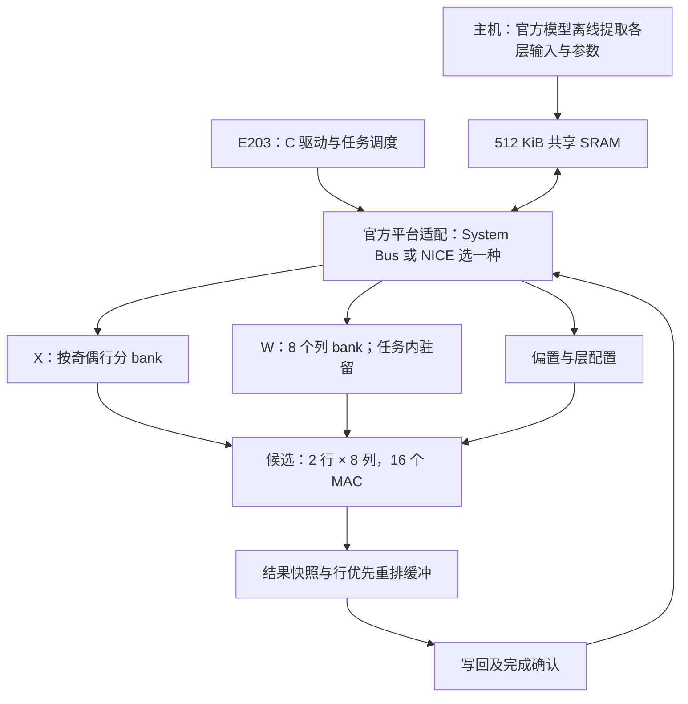

# 本科组冲奖最终作品方案（建议稿）

日期：2026-10-15。适用当前三人团队、剩余20天、已有 migration-v0.2 的条件。本文给出作品目标与实验设计，不代表新增实现或通过验收，也不承诺奖项；奖项取决于正式评测、合格队伍排名和评审。

## 作品定位

建议题目：**面向 KWT-1 的 RISC-V 前馈线性加速系统：指定 SRAM 下的双行权重复用与计算—写回重叠**。

最终作品包含一个真实 E203 SoC、一个完整第一前馈线性层加速器、一套数值与验证工具、指定工艺报告，以及能解释收益来源的对照实验。硬件执行 `Y[99,256]=X[99,64]×W[64,256]+b[256]`，支持12层独立输入和参数切换。

选定的技术问题是：**在指定16位SRAM宏、有限面积和总线开销下，怎样减少同一任务内的权重读取，并让结果写回少阻塞乘加。** 以此组织硬件、软件、实验和答辩。Attention、GELU、第二线性层和完整语音模型硬件化不进入本次20天主线。

当前已经有完整8路核心、位精确模型、官方权重和12层静音回放；下一阶段先补齐真实数据精度、E203、指定SRAM和工艺验收，再将候选优化与合格基线比较。

## 最终系统组成

这是职责与数据流图，具体信号、地址、访存通道以组委会平台为准。A 在D3前选择平台已有支持和例程最完整的一条接入路径；不同时开发两套接口。最终驱动使用批量任务配置，减少每个元素重复写控制寄存器。平台若提供可用的硬件访存通道，可以实现受控块搬运；如果只有CPU搬运入口，先完成该路径并测量瓶颈，不能假设额外DMA已经存在。

公共 E203 NICE 文档包含请求、响应及访存通道，但不能据此认定组委会工程开放了相同配置或地址。参考：[E203 NICE 官方文档](https://github.com/riscv-mcu/e203_hbirdv2/blob/master/doc/source/core/core.rst)。

## 数值与存储方案

沿用 `fixed16_acc48_v1` 候选：X/W为有符号16位，bias为40位，累加和输出48位；64项点积精确计算，中间不截断。C 优先验证现有逐层尺度策略是否够用，再用训练划分进行必要标定；验证集用于评估，不用测试集调参。正式环境还须核对已记录的 TensorFlow 2.4.0 与上游 rc1 差异。

冲奖内部目标建议为**验证集最大层NRMSE≤0.3%**，并记录最差层、裁剪数量和每个性能任务误差。0.3%是自定目标，赛题硬门槛为3%；精度评分按每增加0.3个百分点扣1分，故只擦边通过3%并不适合冲奖。当前静音0.0195108%不能当作真实验证集成绩。

每个性能任务开始清空任务/参数缓存，重新装载本层X/W/b。W在该任务的99行之间复用，任务间不保留权重来获取正式跑分优势。各层X均来自对应层Attention、残差和第一LayerNorm之后，不把上一层线性输出直接串接成下一层X。

共享SRAM只需驻留当前任务及必要软件数据，不要求12层一起放入。当前X/W/b/Y紧凑编码合计198,784字节；若X/W仍按16位、bias和Y各用64位槽则为250,240字节。这两个数字均未计程序、栈、对齐和平台保留区域，A必须据实际链接和地址图完成容量审计。完整Y保存在共享SRAM；加速器内部只增加有限结果缓冲。

## 核心架构：一个主线、两个可验证机制

### 机制一：双行共享权重读取

当前8路核心每拍读取8个W和1个X，计算一行的8个输出。候选结构每拍读取同样8个W和两行各1个X，广播权重给两组8路MAC，即同时计算两行的同一组输出通道。

- W按输出列取模8分bank；每个bank每次读取一个16位字并送给两行乘法器。
- X按行奇偶分成两个bank，保证同时读取两行时不争抢单读端口；实际读延迟随指定宏对齐。
- 99行形成49个完整行对和最后1行；末组第二行关闭有效标记、无效输入读使能和写出，确保只产生25,344个输出。
- bias对两行共用但各自加入对应累加器；全程维持数值模型的有符号和位宽语义。
- W/bias宏按16位宽拆分，记录深度取整、片选、端口和附加寄存器。没有真实宏报告前不承诺面积。

以下为循环结构推导，**不是仿真实测、总线流量或能耗结果**。假设每个归约步只触发所需X/W宏读取，尾组无效X读关闭：

| 结构 | MAC数量 | 每任务W读取的16位字数 | X读取的16位字数 | MAC发起节拍数 |
|---|---:|---:|---:|---:|
| 现有单行×8列 | 8 | 1,622,016 | 202,752 | 202,752 |
| 单行×16列对照 | 16 | 1,622,016 | 101,376 | 101,376 |
| 双行×8列候选 | 16 | 819,200 | 202,752 | 102,400 |

W读数为 `ceil(99/并行行数)×64×256`；候选比单行减少约49.5%的内部W读字数，初次装载W仍是16,384个字。双行候选与单行16列相比，X读数增加、存在末行利用率损失，还增加输出整理和控制成本。因此必须实测总能耗和面积，不能将W读量减少49.5%写成整机能耗减少49.5%。

MAC发起节拍数不含读延迟、排空、偏置准备、结果搬运、回压和SoC。现有8路核心无停顿结构周期为231,264，也不包含装载和最终写回；均不能作为比赛端到端性能。

正式宏基线还应先统一消除明显无效访存：当前RTL在每个发读拍都更新bias读值，而累加仅在first标志有效时使用它。B应核对宏使能，按需要预取并保持bias，随后关闭无用读。这个修正对各配置同样应用，单独记录前后结果，不能把基线额外浪费当成双行复用的贡献。

### 机制二：保持输出顺序的计算—写回重叠

双行调度自然产生交错行的数据，而现有接口要求行优先 `out_index=0..25343`。仅增加小FIFO不能解决这个次序问题。建议使用：

1. 一组16×48位结果快照（逻辑96字节），捕获当前2×8计算块，随后序列化写入行缓冲；不允许新结果覆盖尚未转存的快照。
2. 每组能保存2×256个48位结果的重排缓冲，逻辑3KiB，按行与列地址归位。
3. 两组缓冲交替使用：计算填下一组时，上一组按完整行顺序排出，逻辑总容量6KiB。实际指定宏容量、面积和读写端口另行计算。

每组缓冲具有明确的空闲、填充、可排出、排出状态。尾行只排256个结果。两个缓冲和快照都满时必须逐级回压，冻结相关状态；恢复后无丢失、无重复、无乱序。复位使在途数据失效，下一任务重新完整装载。

这种组织优先重叠**本任务内部的计算与输出写回**，不同时引入整份X/W双缓冲或下一性能任务预装载，控制20天内的实现范围。一个缓冲不可无条件读写抢同一个单端口；双缓冲按真实宏端口安排。系统DONE必须等最后一个结果的所有写事务确认，不能直接使用核心done。

缓冲只能吸收短时停顿。若用约104,000个计算/排空节拍作理想估算，25,344个输出平均约每4拍就需要完成一个结果的外部写回；48位结果跨32位通道至少需要两次有效写传输，CPU搬运还可能增加指令和读开销。该估算只用于尽早发现带宽瓶颈，不能当作候选实测周期或保证；A必须用真实SoC测量长期写回能力。

数据复用和减少搬运本身已有长期研究，例如 [Eyeriss 官方项目](https://eyeriss.mit.edu/)；作品的贡献应落在本题形状、指定宏、奇数尾行、输出顺序和完整系统上的具体实现与可复核取舍，不宣称发明通用权重复用或双缓冲。

## 怎样证明方案值得冲奖

赛题本科评分为功能精度40、SoC/综合/复现20、效率20、自主创新20。必做功能、精度、位一致、时序和面积全部通过后，才进入效率与创新评分。参考本地 [需求追溯](requirements/UNDERGRAD_REQUIREMENTS.md) 与原赛题印刷第9–12页。

| 维度 | 正式验收要求 | 本作品内部追求，均待验证 |
|---|---|---|
| 功能 | 完整形状、12层换参、正常及异常流程；RTL与软件位一致 | 每个已执行测试的全部输出核对，无未解释差异；综合前后核对 |
| 数值 | 逐层汇总全部评测样本，最大NRMSE≤3%；12性能任务各自≤3%；有限输出 | 验证集最大层≤0.3%，保留冻结配置和数据清单；不替代官方600条评测 |
| 时序 | 指定工艺和有效约束下150MHz | 正的时序裕量；不隐藏关键路径或用虚假多周期约束 |
| 面积 | 新增计算、接口和内部SRAM合计≤2.25mm² | 尽量控制在2.0mm²以内留余量；最终以映射及宏面积为准 |
| 效率 | 同一冻结配置完整窗口吞吐/能耗，功耗涵盖CPU/互连/加速器/SRAM | 至少一项系统指标相对公平对照有明确收益，解释另一项和面积的代价 |
| 创新 | 方案、同条件实验、答辩与个人贡献 | 证明收益来自访存组织与重叠，并能指出收益失效的条件 |

最低建议保留以下四个配置，不要求所有配置都成为提交版本：

| 配置 | 设计 | 要回答的问题 |
|---|---|---|
| V0 | 现有1×8核心，适配正式SRAM和SoC，串行计算/输出 | 已有实现的合格系统基线是什么 |
| V1 | 1×16，串行计算/输出 | 单纯增加乘加器能得到多少收益 |
| V2 | 2×8共享W，单组行重排缓冲，计算与整组排出不重叠 | 相同16个MAC下，权重复用是否抵得过X读、控制和整理开销 |
| V3 | V2增加第二组行缓冲，允许计算/排出重叠 | 重叠额外带来多少收益、面积和功耗代价 |

V1与V2比较的是同MAC数的两种完整数据流，须披露实际存储组织差异，不能声称二者面积相同。V2/V3隔离重叠机制；V0/V3是整体变化，不能把全部收益单独归因于复用。所有配置使用相同数据、数值格式、工具/工艺角、时钟/负载、驱动测量口径及任务缓存清空规则；各自都要通过功能与精度。不能拿8路CPU搬运基线与16路硬件搬运候选比较后，把收益全部归于计算阵列。

实验至少展示：12层误差柱状图、位级比较统计、完整窗口周期与瓶颈、W/X真实读使能计数、面积组成、功耗覆盖与每任务能耗、性能—面积—能耗取舍。重叠执行时各模块活跃周期可重叠，不能简单相加为总时长；总时长以统一起止时间戳为准。

最终选择符合门槛且系统收益最好的配置。双行方案若没有收益或导致面积/时序失格，保留数据并选择已验证的单行配置；实验结论可以推翻最初架构假设。未取得平台和库之前，不给出绝对tasks/s、毫焦/任务或获奖概率。

## 最终演示与交付形态

建议演示控制在5分钟左右，准备现场执行与同版本完整记录两种方式：

1. 展示一条真实语音的样本身份，以及官方浮点模型离线提取的指定层输入；清楚标明哪些步骤在主机执行。
2. E203装载该层X/W/b，发起硬件任务，显示完整输出写回、位级核对和误差。预计算参考Y只供比较，不进入DUT或驱动计算路径。
3. 展示12层独立任务切换和全部结果核对，再展示基线与最终配置的同条件实验。
4. 展示指定工艺150MHz、含宏面积和同窗口功耗报告，指向生成命令和版本。
5. 三人各解释一个关键问题：A解释完整任务计时和写回；B解释SRAM、复用和回压；C解释真实输入来源、误差和位一致。

可增加只读结果看板汇总同一批证据，但其开发不应挤占验证时间。演示名称为“真实语音驱动的第一前馈层硬件加速”；未实现完整实时链路时不称“实时端到端语音识别芯片”。FPGA展示是可选补充，不能替代指定工艺验收。

最终文件包含RTL和显式文件集、E203平台版本与驱动、软件数值模型和参数转换、数据划分与校验清单、测试及完整报告、SDC/网表/宏清单、面积时序功耗和活动映射、创新对照结果、架构图、复现说明、来源与个人贡献。涉许可的平台/库按组委会允许的交付方式处理并记录获取要求。

## 三人落地与20天取舍

| 人员 | 最终对什么负责 | 与另两人的关键交接 |
|---|---|---|
| A 系统 | 正式E203接入、批量配置/搬运、C驱动、完整写回、计时和演示 | D3发布平台与打包契约；提供同窗口活动及真实写回输出给B/C |
| B 硬件 | 指定宏映射、合格基线、双行和重排缓冲候选、综合及PPA | 保持外部协议或明确升级；提供每版RTL/宏/SDC/报告，解释全部额外面积 |
| C 数值验证 | 正式数据、尺度冻结、位级/误差检查、四配置对照与复现 | 发布带版本的真实向量和Golden；独立核对A/B输出；保留失败与修复记录 |

采用现有 [20天计划](TEAM_PLAN_20_DAYS.md) 的阶段门：D1–3材料与接口，D4–7真实精度/指定宏/首个SoC任务，D8–12完整12层与资格基线，D13–16集中比较和选择优化，D17–20冻结、复现、报告和答辩。候选可在隔离配置中提前验证，但不能破坏共同基线。

**退出条件：** D3材料未到，明确正式验收阻塞并追齐；D12资格未通过，取消新增架构开发，集中修复；D16仍未完成回归或没有可信收益的候选不进入提交版本。规划日期为2026-10-15至11-03，不代表官方截止日。三人每日只同步交付、阻塞及次日依赖，接口或数值变更须更新契约、版本和相关证据。

本文把“冲一等奖”落实为一个完整系统、一条明确技术主线和一组可审计实验。实际实现及成绩仍以PROGRESS和绑定源码的报告为准。
