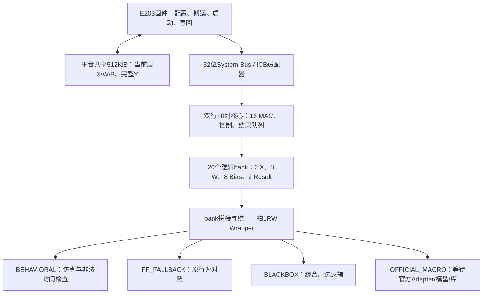

# KWT-1 + E203：当前框架、审计结论与修改计划

审计日期：2026-10-18。本文是当前计划入口，依据真实源码、正式赛题和原始报告整理；10月17日、18日早期计划及失败记录保留。创建时只做审计/计划；后续执行已完成A及B的参考候选验证，最新结果见第7节，不能将早期待办当作当前未实施状态。

## 1. 要交付什么

保留已有第一线性层、数值模型、CPU驱动和FF基线，完成“存储可替换、功能可回归、综合边界可检查、官方文件到位后能低风险接入”的开发版。官方验收另需指定平台、工艺和SRAM；开发版通过不能代替比赛全部通过。

固定条件：`Y[99,256] = X[99,64] × W[64,256] + Bias[256]`，12层依次重新装载；X/W signed16、Bias signed40、精确内部41位、外部signed48，保留Golden和舍入规则。150MHz不降频；正式面积上限≤2.25mm²，项目内部继续采用更严格的<2.25mm²目标。

正式PDF印刷第3页明确不要求布局布线、物理验证、流片。第12页面积为新增加速器、接口和内部SRAM之和；复用E203、共享512KB和固定外设面积单列。Nangate45仅是参考库，不能据此宣称正式合规。

## 2. 当前工程框架

当前采用System Bus/ICB集成，赛题允许其与NICE二选一，没有必要再开发第二套NICE路径。共享区和内部bank是不同层次；共享区当前层数据由CPU搬入内部缓存，属于当前数据流所需的计算副本。内部不保存全部Y，只容纳最多4行结果，CPU将完整Y写回共享区。

| 层次 | 当前文件/目录 | 本轮处理原则 |
|---|---|---|
| 不可变来源和原实现 | `vendor/`、原`kwt_linear_engine_rowpair.sv`、原`kwt_icb_slave.sv`、队友原仓库 | 保留，互斥源集；不原地重写 |
| 数值与向量 | `model/`、`sim/vectors/`、固定真实导出manifest | 不修改Golden迎合RTL；绑定SHA |
| 计算候选 | `src/rtl/kwt_linear_engine_rowpair_sram.sv` | 保留MAC、调度、精度和数据流 |
| 存储边界 | `src/rtl/memory/` | 已有bank/1RW/黑盒；官方Adapter待接 |
| CPU接入 | `soc/kwt_icb_slave_sram.sv`、`soc/firmware/kwt_smoke_sram.c` | 保持寄存器协议和实际响应语义 |
| 开发平台 | `integration/ChipContest/`、`sim/kwt_shared512_checked_model.sv` | 开放Fork证据，不能冒充组委会平台 |
| 验证和综合 | `scripts/verify/`、`scripts/synth/`、`tests/`、`Makefile` | 显式后端/源集；原生退出、完整标记、SHA共同验收 |
| 工艺交付入口 | `tech/official_sram/`、`configs/sram-backends.json`、`constraints/` | 未知值不补零；缺Adapter明确失败 |
| 上下文/回滚 | `PROGRESS.md`、`DECISION.md`、`docs/USER_CHANGELOG.md`、harness | 短状态、决策、负责人记录分别维护；保存源码实际字节 |

## 3. 存储审计的十个答案

| 问题 | 当前核查结论 |
|---|---|
| 1. 有多少存储实例？ | 选定双结果buffer候选有20个AI逻辑bank，对应72个容量原语。平台另有共享区、ITCM、DTCM三个主要payload对象；CPU寄存器文件/ROM/debug/FIFO另列，不能把互斥候选或源码定义数累计为物理宏总数。 |
| 2. 容量、位宽、用途？ | X：3200×16及3136×16各1；W：8×2048×16；Bias：8×32×40；Result：2×512×41。总415744bit=50.75KiB。各按1RW使用；宏形状拼接见下表。 |
| 3. 哪些是共享SRAM？ | 开发共享区131072×32=512KiB；ITCM和DTCM各64KiB，均为平台资源。20个bank才是AI内部存储，不能从加速器面积中漏掉。 |
| 4. FF/MUX用了多少？ | 历史全容量FF结构有429231寄存位、26801个宽字RTLIL mux、21个pmux、0残留memory；不是26801个门级MUX，也没有当前全核FF门级面积/STA结论。 |
| 5. 时序/极性/保持？ | 逻辑使能高有效，posedge采样，同步一拍读；无读时Q保持、valid清零。reset清控制/valid而不清payload/Q；首次合法读取前Q无定义。官方引脚极性仍未知。 |
| 6. 是否依赖异步读？ | 当前AI payload本来就是同步读，现有metadata已对齐，不需无依据增加READ_WAIT。E203 GPR/debug及队友独立XRowBuffer存在异步读，不能一起替换。 |
| 7. 哪些已有Wrapper？ | 原rowpair直接数组保留；新候选为core→bank→1RW→后端。TCM保留平台Wrapper，官方Adapter只有逻辑接口，尚无真实实现。 |
| 8. 冲突/未知/越界？ | 当前候选结构check通过；内部行为模型检测未知使能/地址/写数据、越界、未写读取和同bank同拍读写。共享模型只做协议/地址检查，没有内部known bitmap，不能把内部SRAM的全部检查结论扩大给共享区。 |
| 9. 是否已展开大SRAM？ | BLACKBOX映射保留72个opaque实例，没有意外全容量FF展开；FF模式才显式memory_map。CPU寄存器和小队列仍属于标准逻辑。 |
| 10. 官方接入还缺什么？ | 官方功能/引脚/读延迟/碰撞规范、Liberty、面积功耗表、指定标准单元/PVT和正式平台。参考ECO场景回放及已覆盖min检查已通过，但宏切口/两态/参考角限制仍在；全输入形式未证明。 |

| 数据 | 逻辑bank | 容量原语组合 |
|---|---|---|
| X | 2 | 每bank 3×1024×16 + 1×128×16；奇行尾部64字不可访问 |
| W | 8 | 每bank 2×1024×16 |
| Bias | 8 | 每bank 3×128×16，宽度补齐到48位 |
| Result | 2 | 每bank 4个128深度片×3个16位宽度片 |
| 合计 | 20 / 50.75KiB payload | 50×128×16 + 22×1024×16 = 72片 / 56.5KiB |

5.75KiB填充不是功能数据，也不是已验证最优宏面积。没有官方面积和端口代价前不优化这部分，更不同时改缓存、bias组织和MAC。

当前数据流无需双端口，因此只实现并验收1RW；同bank同拍读写全部禁止，不把未规定的同址碰撞当作功能。官方需要双端口时按真实需求扩展，避免预先造接口。

## 4. 真实进展与缺口

| 范围 | 当前状态 | 证据含义 |
|---|---|---|
| 单元与双后端 | PASS | 67案例：25正常+42预期拒绝；7组匹配 |
| 核心/总入口 | PASS：开发功能 | `make regress`20阶段；新核心76任务/1926144输出，另原版12任务 |
| E203 CPU集成 | PASS：开发平台 | 12层304128输出、608256输出写响应、12 ACK；真实soft abort及pending响应外部reset恢复 |
| 参考BLACKBOX映射 | PASS | 72宏保留、16 MAC；最终ECO版46035标准单元、0.057015238mm²标准逻辑面积，缺宏面积 |
| 参考STA | 已覆盖路径PASS | ECO版setup最差+4.652084ns；data hold+0.001379ns；removal+0.055262ns。原SDC/统计wireload，宏切口边界不完整，非正式签核 |
| 综合前后功能 | 场景回放PASS / 形式NOT_PROVEN | 最终ECO的12层304128输出及恢复/背压通过；两次历史形式超时保留，全网四态未执行 |
| 主机/证据工具 | PASS | 当前324项主机检查及静态入口通过（材料预检、契约及新增8项覆写/reset工具检查；详见当前来源索引）；各类设计结论另看实际证据 |
| 参考已知负载电气 | PASS：限定范围 | 48378标准输出/32类上限，cap/transition/clock无报告违例；182宏输入负载与1152宏输出驱动仍未知 |
| 正式SRAM/指定PPA/正式平台 | BLOCKED | 官方文件未收到，完整150MHz、总面积、功耗保持未知 |

开发SoC窗口21261300周期包含CPU配置、搬运、计算、等待与写回，但排除TB backdoor预装载及中断epoch，不能当正式完整装载性能。

创建计划时的门级编译告警针对`y_snapshot`符号扩展别名，另有采样/共同X及末响应覆盖缺口。A批已通过最小工具探针、四态checker、实际驱动观测及重跑关闭这些场景缺口；结构无环本身仍不作为功能证明。历史失败保留，最新场景接受不升级为全输入等价。

本轮证据：`docs/runs/sram-framework-audit-20261018.json`；历史功能索引：`docs/runs/sram-implementation-20261018.json`。长日志保留原目录，不改写旧失败。

## 5. 增量修改顺序

### A. 先收口综合后功能验证（最高优先，约0.5–1工程日）

**涉及：** `sim/tb_kwt_icb_mapped_pair.sv`、`scripts/verify/run_sram_mapped.py`、`tests/test_sram_mapped.py`，必要时新增最小诊断fixture；验收后再加入Makefile独立入口。

1. 用单触发器+符号扩展fixture复现当前UNOPTFLAT；保存按位拓扑证据。若确认是表示/调度问题，采用可追溯的连接拆分处理，保持accepted mapped.v原字节不变；不靠屏蔽告警宣布通过。
2. TB使用稳定采样点，实际posedge握手计数；控制/有效数据显式拒绝未知值。每层向量读取前清为未知，并由runner核验文件、词数、位宽、SHA及消费字节；两态仿真不能替代四态检查。
3. 补末HI与ACK响应背压、错误命令、busy abort后全量重装、pending响应外部reset，防止只覆盖正常完成路径。
4. 先1层，再12层；逐位核对25344/层输出、顺序、done、backpressure与恢复。通过故意损坏私有网表/向量副本的负例，证明检查器确实会失败。
5. 独立审查native退出、模型来源、72宏、功能单元覆盖、markers和运行前后SHA。只能宣称已覆盖场景的同源零延迟门级功能通过，形式整体证明仍保留NOT_PROVEN。

**验收：** 编译诊断有结论；正例完整结束；负例被拒绝；12层全结果和协议检查通过；不继承RTL PASS作为网表PASS。

### B. 再处理参考最小延迟问题（约0.5–1.5工程日，结果不保证）

**先改范围：** 参考映射/STA脚本及报告；确需设计修复时再新增独立RTL候选，不覆盖已验收候选。

1. 固定当前RTL、库、SDC、wire-load，分开汇总read_valid→accumulate_valid的data hold，以及soft_reset→异步RN的removal。
2. 优先评估工具支持的映射/缓冲修复及其setup、面积、扇出/负载代价，禁止放宽uncertainty或加false/multicycle path。
3. 若参考工具不能合法修复，保留FAIL；对软abort的同步clear候选先评估清除周期、输入新鲜度、响应保留、结果队列及重新START的影响，再选择一个最小改动。不能随手把异步reset换成同步reset。
4. 任何RTL变更生成新身份，重跑相关单元/核心/协议/SoC、综合后功能及STA；旧源码证据只属于旧版本。

**验收：** setup、data hold、recovery/removal分别出具结论。只称参考已覆盖路径，不把72宏边界未知的正Slack称完整150MHz达标。没有可靠收益时不纳入开发交付。

### C. 开发版冻结与交接（约0.25–0.5工程日）

**涉及：** Makefile、README、当前审计/PPA/接入手册、harness与负责人记录。

- 根据实际改动重跑最小相关检查；只有RTL或依赖变更使证据失效才重跑完整回归，不重复已接受的大实验。
- 将功能、工具完成、参考已覆盖路径、官方PPA阻塞分别列出；修正README中仍写“待实现/尚未SoC”的历史概述。
- 保存源、向量、工具、网表/ELF、日志与报告依赖；生成有源码实际字节的checkpoint并异目录核验。根目录不是有效Git，不初始化、覆盖用户修改或虚称commit。

**验收：** 新成员可依README从`env/activate.sh`和Make入口复现；官方缺项明确；原FF/原RTL/Golden可恢复。当前无依赖开发收口约1–3工程日，不承诺参考时序一定转绿。

### D. 官方文件到位后的接入（当前BLOCKED）

**涉及：** `tech/official_sram/`、新的`kwt_official_sram_adapter`、后端配置与官方构建约束；正式平台差异集中在独立集成层。

依次确认版本/授权/SHA→单/双端口与CE/WE极性→地址/写掩码→读延迟与Q保持→碰撞规则→真实宏组合。接入功能模型后重跑单元、行为/FF/官方对照、12层及正式CPU流程；接入Liberty后做指定PVT的综合前后功能、全路径setup/hold/覆盖、全部新增面积和统一窗口功耗。具体表单见`docs/OFFICIAL_SRAM_INTEGRATION.md`。

若官方宏不满足当前一拍契约，先提出Adapter/READ_WAIT/metadata对齐影响再实施，禁止只延迟valid。完整装载窗口必须按官方环境重建，不能沿用开发TB backdoor窗口。资料完整且接口兼容后的首次接入可暂按2–5工程日预留；拿到包后重新估算，不包含等待时间或重大延迟差异改造。

## 6. 长流程约束与停止条件

每批：冻结输入→实现单一改动→最小正/负例→阅读日志→修复→独立检查→更新PROGRESS/DECISION/负责人记录→checkpoint。只读审查可并行，HDL编译最多2线程，重型EDA一次一项。本机现有工具可执行上述前置工作，当前不需新装EDA或占用服务器。

保留历史失败；两次同方法无信息增益就换方法。官方资料只阻塞D，不阻塞A/C。数值格式、重大架构、接口契约或大规模资源变更需单独决策；本文没有提出这类改动。计划不是执行结果，未运行的检查明确NOT_RUN。

## 7. 本计划开始执行后的状态

**A批已完成所测开发范围：** 三版alias各48检查、四态checker21案例、真实1层和12层同源网表回放、错误Golden负例及构建复用；12层304128输出、恢复/错误/末HI/ACK背压通过。全网四态及形式全输入证明仍未完成，不把场景回放推广。读旧报告格式的窄恢复独立保留原producer/失败。证据`docs/runs/sram-mapped-functional-20261018.json`。

**B批参考候选验证完成：** BUF_X8/X16探针仍负后停止该方法；完整独立网表共增加9个真实BUF_X1、reset驱动X1→X16、一处NOR4_X1→X2。交接前全网cap发现4驱动超限后再增加4处同函数NOR3/4强度替换。最终原SDC下setup+4.652084ns、data hold+0.001379ns、removal+0.055262ns；新网表重新完成1层/12层304128输出，已知全网cap/transition/clock通过。宏72片、外部端口、RTL/Golden保留，逻辑面积相对原版+17.822μm²。方法与限制见`docs/optimization/SRAM_REFERENCE_ECO.md`；不是官方完整150MHz或稳健角裕量结论。

**C：** 参考模型内电容覆盖已完成分类，未知项不补零；新增`make check-reference-electrical STA_REPORT=...`实跑通过。最终索引为`docs/runs/sram-reference-cap-closure-20261018.json`，负责人记录、独立审查及实际源码快照按阶段保存。614文件旧源码包异目录恢复/202主机检查通过只适用于该包，后续新增脚本另做当前快照，不夸大旧镜像。

**D材料工具已补，真实接入仍BLOCKED：** 新增独立`official-sram-package.json`和分阶段文件预检，支持仿真材料先到、仿真/综合不同源集及同库跨角色去重。22新增工具测试、9个原生CLI和全226主机检查通过，真实空清单仍BLOCKED。见`docs/OFFICIAL_SRAM_INPUT_READINESS.md`及`docs/runs/official-sram-intake-20261018.json`。该工具不设置旧READY，不解析HDL/Liberty、不编译或证明宏；旧选择器及开发CLI保留，实际official回归仍待真实包接通。

接下来的依赖是官方宏模型/引脚时序/Liberty/面积功耗/PVT及正式平台身份。拿到后先核来源与文件，再实现Adapter/官方回归及指定工艺验收，不继承当前典型角或开发Fork结果。上文A/B任务内容及失败保留为执行依据。

**D入口前置已进一步完成：** 独立BACKEND=3原语/bank入口已消费simulation文件计划，8开发场景/23177检查及15类非法请求拒绝、8原生CLI与238主机检查通过。缺包0条HDL；开发夹具不是官方宏。详见`OFFICIAL_SRAM_CONTRACT_RUNNER.md`及原生`official-sram-contract/final-v2/result.json`。真实模型、辅助依赖及核心/ICB/CPU官方接线仍待完成；覆写/reset开发定向激励已另行完成如下，不能把此处资格化升级为官方功能/PPA。

**D的开发定向补测已完成：** 新独立TB/runner通过默认两后端16场景/720检查及显式开发三后端24场景/1080检查、8组MATCH；3私有故障均准确拒绝，全246主机检查通过。首末/物理tile边界不同值覆写、持续reset读写enable及释放/无posedge短reset已有真实证据，见`SRAM_UPDATE_RESET_VALIDATION.md`、`runs/sram-update-reset-20261018.json`。旧830来源不变，原RTL和旧runner保留。真实官方包仍需重新运行此补测，并接通核心/ICB/CPU及正式PPA。

**D的核心/ICB入口已准备并开发资格化：** 新`run_sram_adapter_system.py`先消费simulation文件计划并完整再验同输入原语PASS，才执行BACKEND3。12真实静音层/304128输出两态及2极值/50688输出四态通过；四态ICB真实25348输出、86保持与1reset丢弃，2监视器故障拒绝。262主机检查通过、1346文件索引含旧1096不变，见`SRAM_ADAPTER_SYSTEM.md`。旧CLI/RTL未改，真实Adapter及CPU/SoC、指定PPA仍待对应材料，不继承开发夹具PASS。

**D的CPU入口已完成开发资格化：** 新`run_sram_adapter_soc.py`先完整复核同Adapter原语及核心/ICB证据，固定原136平台源，仅私有生成2份接线副本。首次CPU长测实际12层304128输出、275712装载、608256输出写响应、12 ACK及两种恢复通过；开发窗口21261300周期；旧语音/新静音输入不同，相同形状/固件下测得周期相同，非隔离后端A/B。281主机检查及静态入口通过，见`SRAM_ADAPTER_SOC.md`。旧平台2 UNOPTFLAT/15 LATCH完整诊断不变；两态、静音smoke、TB预装载窗口边界保留，不称官方平台/宏或正式性能通过。原计算RTL/Golden/FW/平台未改，原前置失败和源码档案保留。

**C的CPU路径迁移已实际验证，交接包收口中：** 新版本化入口显式选择本机新baseline及平台/编译工具；136源相对路径/SHA精确核对，不搬改旧报告或重绑v1全局。新独立平台目录真实生成行为12层，再用新报告完成v2 Adapter12层，各304128输出/608256写响应/12ACK及恢复；48文件同workload，开发窗口均21261300周期。6CLI门槛、38 reader+5入口新增检查及全324主机检查通过。旧1830来源保持，说明`SRAM_CPU_REBUILD.md`；同机复用工具的目录重建不是独立OS/官方宏或正式PPA验证。
