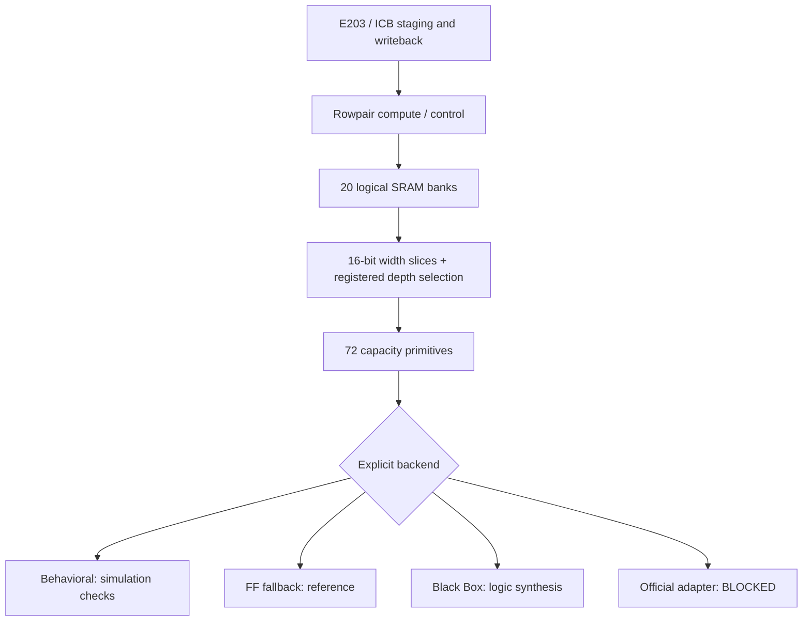

# SRAM 子系统与复现入口

本轮保留原 `kwt_linear_engine_rowpair.sv`、原 ICB adapter 和全部历史证据，新增独立 `kwt_linear_engine_rowpair_sram` / `kwt_icb_slave_sram`。数值格式、MAC、FSM、端口协议及计算调度保持原设计；存储阵列从计算逻辑移到统一边界。



## 时序与访问约定

每个逻辑 bank 每拍最多一次读或一次写。地址在上升沿采样，同步 Q 和 `rd_valid` 在该沿后有效；无读时 Q 保持、valid 清零。原 rowpair 已采用同一契约，因此没有增加 READ_WAIT，也没有改变首项、尾项、排空和写回时刻。新核心用仿真断言逐拍核对 X/W/bias/结果返回与现有 metadata 的对齐。

复位只清控制/valid，不清 payload；仿真 written bitmap 同样保留。每个任务仍必须正常装载全部 X/W/bias，结果 buffer 只有写全并取得所有权后才读。任何同 bank 同拍读写均禁止，包括不同地址；当前数据流无需物理双端口。行为模型检测未知使能、地址/写数据、越界、未写读取和端口冲突。无批量清零代替数据装载。

`kwt_sram_bank` 保存返回的深度片选，按 4096、1024、128 的容量模板拼接；宽度向16位取整。当前20个逻辑 bank 被拆成50片128×16和22片1024×16，配置56.5 KiB，逻辑payload50.75 KiB。它是可测试的拼接实现，不是已知面积最小的组合。官方 Adapter 负责真实 pin/极性/保持/时序；若官方延迟不能满足一拍，必须显式修改标签与等待控制并重新验收。

共享512 KiB开发模型独立于内部 SRAM，不进入加速器综合文件集。新增 checked 版本将所有非32位对齐地址明确报错，读请求忽略写掩码；原模型保留。现有 CPU 固件已使用 aligned32 装载，不依赖未核实的 halfword 返回约定。未修改 E203 核心功能。

## 模式和命令

模式清单见 `configs/sram-backends.json`，`scripts/verify/sram_sources.py`供核心、ICB、SoC、黑盒和FF综合入口统一选择并绑定SHA；原语单测按显式最小文件集独立编译。选择器拒绝重复/缺失/越界文件、错误后端值及不兼容用途。行为模型在 `SYNTHESIS` 下拒绝；Black Box 仿真主动失败；官方模式缺 Adapter 时编译失败，均不会静默回退。

```bash
source env/activate.sh
make test-memory                 # 四态单元、bank拼接、错误负例、共享模型
make test-linear                 # 行为后端，12层、完整矩阵及回压/复位
make test-linear-ff              # 相同协议的FF后端
make test-soc                    # E203开发平台，2个完整CPU任务
make test-soc-full               # 12层CPU开发窗口；不含TB预装载，耗时数分钟
make synth-memory-blackbox       # 全top结构，拒绝意外FF展开
make synth-logic                 # Nangate45参考逻辑映射，不含宏PPA
make test-icb                    # 真实核心双后端协议、回压、abort/reset
make regress                    # 主机+单元+4配置双后端+12层+四态+ICB+12任务SoC
make test-mapped-checker         # 四态检查器3合法/18精确预期拒绝，不是加速器任务
make test-mapped MAPPING_REPORT=<含接口mapping结果> MAPPED_TASKS=1
make test-mapped-negative MAPPED_REUSE=<已通过1层回放结果>
make test-mapped MAPPING_REPORT=<同mapping结果> MAPPED_REUSE=<已通过1层回放结果> MAPPED_TASKS=12
```

默认向量是随源码提供的12层静音输入/真实权重。真实语音回放可指定已验证的导出目录：

```bash
make regress SRAM_VECTORS=artifacts/runs/20261015T091234Z-speech-smoke/export
```

该导出来自开发验证划分单条语音，不是完整数据集RTL精度认证。丢失时按 `docs/optimization/DATASET_EVALUATION.md` 恢复数据及固定样本并用 `scripts/model/export_kwt.py --waveform ...` 重导出。所有新运行创建唯一 artifacts 目录，保存命令、原生退出码、完成标记、输入/工具/日志 SHA；禁止只摘 PASS 字样。

综合与STA的实测边界见 [初步PPA](../reports/PPA_PRELIMINARY.md)，官方到位后的逐项步骤见 [接入手册](OFFICIAL_SRAM_INTEGRATION.md)。Black Box 的空面积/空时序弧不等于零成本，不能据参考逻辑面积判断总面积或功耗达标。


## 当前验收纪律（2026-10-18）

SoC使用独立`tb_e203_kwt_sram.sv`和`kwt_smoke_sram.c`，原TB/固件保留。先由CPU进行busy→soft abort预检查，再在延迟的真实共享写响应中断言现有外部reset，等待平台实际复位与重启；不force E203内部信号。重新完整装载task0，丢弃中断epoch后再统计正常任务。

每任务核对22976个load commit、25344结果、50688个输出写响应和1个ACK响应；最后完成邮箱响应在posedge消费后才完成。窗口名为`development_window_cycles`，从CPU任务释放到最终响应，包含配置、搬运、计算、等待及写回；共享区TB backdoor预装载不在该窗口，不能当官方完整输入装载性能。恢复测试开销单列，不混入完成任务。

run_sram_soc记录ELF/BIN/HEX/simulation的运行前SHA，结束复核；TB只消费校验器返回字节的独立暂存副本。总回归再次核对原生子命令、设计标记、任务计数、请求配置及源/数据/日志SHA，不仅检查stdout里PASS。超时/中断清理本任务的进程组和已确认身份的派生进程，避免内层新session遗留。

原版参考时序见`docs/optimization/SRAM_TIMING_ANALYSIS.md`，其data hold和soft-reset removal失败保留。当前第四独立ECO重新完成参考已覆盖setup/hold/removal、48378标准输出已知电气及12层门级回放；详见`docs/optimization/SRAM_REFERENCE_ECO.md`。hold仅1.379ps，真实宏负载/时序及正式工艺未建模，不能称完整150MHz通过。

门级功能回放以同一真实标准单元网表、同源Liberty功能模型和共同逻辑SRAM契约比较RTL/门级响应与Golden。`mapped_alias.vlt`只定点拆分`y_snapshot`向量调度，原网表仅改仿真顶层名，不关闭UNOPTFLAT告警。被TB观测的状态须在实际网表中有唯一驱动；已被优化掉的旧名字不能当观测点。该回放是Verilator两态、零延迟范围，四态21例单测只资格化检查器，不能称全网四态/形式/时序通过。

复用已通过binary时，独立`run_sram_mapped_replay.py`保留生产者的源/工具/模型recipe/原生命令/二进制检查，只兼容历史`bytes`/`size_bytes`长度键；可选`project_relative_path`须解析为同一实际路径。哈希或长度冲突仍拒绝，旧producer及失败报告不改。负例仅修改私有Golden副本第0输出的一位，期望确切失败并记录EXPECTED_REJECTION，不计入正常任务。

官方材料现增加独立文件准入工具，见`docs/OFFICIAL_SRAM_INPUT_READINESS.md`。它按仿真/综合/时序/PPA输出文件计划并核SHA，不运行官方后端；冻结的旧选择器/CLI尚需在真实包到位后接通。不能把FILES_VERIFIED或修改READY当作官方功能通过。


原语/bank层现有独立[BACKEND=3契约入口](OFFICIAL_SRAM_CONTRACT_RUNNER.md)，默认消费simulation材料计划，缺包不启动HDL；显式开发夹具资格化不算官方宏通过。旧核心/ICB/SoC CLI仍保持开发源集，真实模型及后续接线尚待完成。


后续新增[Adapter核心/ICB功能入口](SRAM_ADAPTER_SYSTEM.md)，消费simulation源计划并重核同输入原语报告后才运行BACKEND3；开发夹具的14核心任务和四态ICB已资格化。旧CLI保持原字节；真实宏/CPU/正式SoC和指定PPA仍需实际文件及新验证，不能把文件核验或开发PASS当作官方通过。
