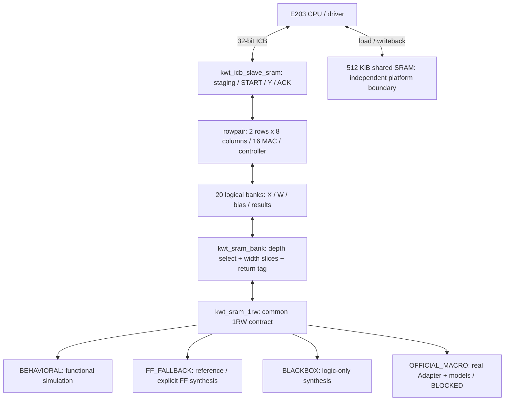

# KWT-1 + E203 可替换 SRAM 子系统设计说明

> 2026-10-18复核：以下框架和接口契约继续作为设计依据；文中“本轮尚未修复/尚未运行”描述保留10月17日历史状态。当前真实进度见SRAM_AUDIT第12节及 [剩余修改计划](../plans/2026-10-18-sram-remaining-plan.md)。

状态：**Proposed，计划审查稿**。日期：2026-10-17（Asia/Shanghai）。本文件响应用户“先用计划模式完成审计并给出修改计划”；本轮仅核对现况和整理文档，不启动新 RTL 修改、仿真或综合。上轮已产生的候选和失败证据保留。

## 1. 目标与成功条件

保留既有第一线性层计算/调度和软件数值模型，将存储实现隔离为可选择后端。没有官方 SRAM 时，能够真实运行功能仿真、E203 开发联调和逻辑预综合；官方文件到位后集中替换 Adapter 与构建配置，再完成正式验收。

固定要求：`Y[99,256]=X[99,64]×W[64,256]+B[256]`，每任务重新装载，依次支持12层；150 MHz；内部使用指定16×128/1024/4096单/双端口宏组合。正式 PDF 面积上限为 `≤2.25 mm²`，本项目执行用户更严格的 `<2.25 mm²`；范围为核心逻辑、新增接口逻辑、内部 SRAM 宏之和。E203、共享512 KiB和固定平台逻辑面积另列，功耗仍须计入完整任务窗口。

本轮保持 `fixed16_acc48_v1`：X/W signed16，bias signed40，内部精确41位累加/结果，接口 signed48；不改变量化、舍入、模型、Golden或计算归属。当前4,445条软件开发精度证据和新存储 RTL 的逐位证据分别报告，不能互相替代。

## 2. 已核对的现状

- 根目录不是有效 Git 仓库，`.git` 为受保护空目录；不自动初始化或更改它。本阶段以 SHA manifest / checkpoint 回滚。队友主仓库和 E203 子仓库均无 `git status --short` 输出，分别固定为 `30e737ca…` / `35e7c960…`。
- 相对 `sram-pre-refactor` checkpoint，原492个文件没有缺失；原 RTL、Golden、固件和平台源未被改写。已有文件变更为 Makefile、README、harness/tasks，存储候选以新文件增加。本计划文档和当前状态记录另计。
- 迁移基线、banked/opt/rowpair均保留。原 rowpair 直接声明20个同步数组，已有 RAM 保留结构综合；不能说本项目现有全部容量已经映射成门级FF。
- 新 `kwt_linear_engine_rowpair_sram`、`kwt_sram_bank`、`kwt_sram_1rw` 和独立 ICB/shared候选已落盘；当前审计要补齐其验收，不重复从头开发。
- 当前单元51案例/7组匹配、12个新核心运行及1个原核心对照有完整历史日志和当前匹配SHA。12任务SoC及整套regression没有最终结果，不能接受为PASS。
- 含 ICB 的预综合失败；core-only参考映射有结果；局部STA执行完成但时序失败。具体证据见 `docs/SRAM_AUDIT.md` 的本轮补充及 `docs/runs/sram-plan-audit-20261017.json`。

## 3. 方案比较与选择

| 方案 | 收益 | 代价/风险 | 本轮取舍 |
|---|---|---|---|
| 保留rowpair，通过逻辑bank/原语wrapper隔离后端 | 改动集中，能与原版逐位/周期对照，官方接入边界明确 | 仍保留原容量和bias浅bank填充 | **推荐**，完成已有候选的缺口 |
| 同时重写为更小分块缓存/集中bias调度 | 可能减少内部宏或访存 | FSM、装载协议、延迟和吞吐都需重验，宏收益尚未知 | 后续独立优化，不并入存储抽象首版 |
| 继续全容量FF作为默认综合 | 早期工具简单 | 几十万状态位和大量选择逻辑，不符合真实宏成本 | 仅保留显式对照，正式入口默认黑盒 |

## 4. 总体框架与职责

计算核心只负责地址/使能、MAC和所有权；bank层负责深度片选、宽度补齐、返回片选；原语层负责后端选择和合法访问契约；官方Adapter负责真实引脚、极性、保持、延迟和测试/电源端口。共享SRAM与TCM不由AI内部wrapper一并替换。

保留现有目录：`src/rtl/memory/`、`soc/`、`sim/`、`scripts/verify/`、`scripts/synth/`、`tech/official_sram/`。不为目录美观移动旧文件，不递归混编vendor或多个候选。

## 5. 存储组织与容量

| 对象 | 逻辑bank形状 | 逻辑容量 | 当前容量模板 |
|---|---|---:|---|
| X | 3200×16、3136×16 | 12,672 B | 各3×1024+1×128，合8片16位原语 |
| W | 8×2048×16 | 32,768 B | 每bank2×1024，合16片 |
| bias | 8×32×40 | 1,280 B | 每bank3个宽片×128，合24片 |
| 结果双buffer | 2×512×41 | 5,248 B | 每bank3宽片×4个128深片，合24片 |
| 总计 | 20个逻辑bank | 51,968 B / 50.75 KiB | 72片，57,856 B / 56.5 KiB |

72片只是可验证的容量模板，不是已实例化官方宏或最小面积证明。填充5.75 KiB主要来自bias，适合待宏面积/访问代价明确后再评估集中预取。W仍按 `bank=c%8, word=k*32+c/8`，不可直接复制队友 `group*64+k` 的bank镜像。

内部只保存最多4行结果；完整99×256结果写回共享区，不新增完整Y副本。开发地址图：X=`0xa0000000`，W=`+0x4000`，bias=`+0xc000`（40位按8字节对齐），Y=`+0x10000`（48位按8字节对齐），任务邮箱=`+0x7ff00`。各区不重叠且位于512 KiB范围内。

## 6. 时序和后端契约

通用接口：`kwt_sram_1rw #(WIDTH, DEPTH, BACKEND, CHECKS, INIT_FILE, ADDR_WIDTH)`；端口 `clk,rst_n,wr_en,wr_addr,wr_data,rd_en,rd_addr,rd_data,rd_valid`。

- 每bank单端口1RW，当前无需双端口；任何同拍读写（包括不同地址）禁止且检测，不能擅自定义官方碰撞值。
- 请求在上升沿采样，Q及valid于该沿后有效；无读时Q保持。深度片选与Q同沿更新，保持原一拍读契约。`PIPE_MUL=0/1`均必须与原标签对齐。
- 原核心已同步读，当前不增加READ_WAIT；若官方宏不能满足此契约，则明确升级延迟适配/控制修改并重新设计验证，不能只延迟valid。
- reset清valid/control，不清payload、不靠全清零加载。非法地址、未知信号、未写读和不完整HEX初始化均应拒绝。
- `BACKEND=0`只仿真，综合拒绝；`1`仅逻辑黑盒，功能仿真拒绝；`2`保留FF，完整容量综合需显式opt-in及资源上限；`3`要求真实外部Adapter，缺失则编译失败，不静默回退。
- 当前不需要内部byte mask；共享总线模型保留aligned32+byte mask语义，错误请求必须无存储副作用。官方若带mask，由Adapter将全字写映射到真实控制。

## 7. 必须先修复/补证据的缺口

1. **ICB组合环**：`request_ok → engine_start_valid → core.load_ready → request_ok`。最小候选是staging/COMMIT合法性检查改用不依赖start_valid的idle/error/reset条件，保留真实握手和START校验；必须证明这些offset与START互斥，先复现失败，再回归。原adapter不覆盖。
2. **SoC证据与计时**：旧12任务执行句柄不可恢复且无最终报告，不宣称PASS，也不判算法FAIL。新runner应持久化PID/命令/退出码/阶段与中断状态，保证下次可核查；生成simulation/ELF/BIN/HEX均记录SHA。旧TB在negedge看到响应valid/ready即结束，尚未证明随后posedge实际消费；须按有效时钟沿记录响应接受，再结束测试。开发窗口从CPU任务释放/调度开始、覆盖全部配置和搬运，到全部结果写回与ACK响应结束；当前共享区backdoor预加载不计入该开发窗口，所以仍不能称正式比赛窗口。正式计时须绑定实际输入/参数装载起点（含平台加载接口）、全部总线等待和写回，等待官方平台核定。
3. **协议覆盖**：复用 `sim/tb_kwt_icb_slave.sv`，建立候选绑定，覆盖错误命令无副作用、LO/HI原子性、响应背压、忙时装载/重复START、在途abort/reset及再次完整任务。正常12层CPU程序不能代替这些负例。
4. **参考STA失败**：历史WNS=-22.923624ns/TNS=-22525.019531ns；原始hold报告另有-0.004303ns。最差setup路径是read-valid控制到乘积寄存器保持MUX，INV/NOR输出分别有499/472个sink pin，存在极大的单元负载延迟。先检查fanout/cap/slew和ABC缓冲/驱动/负载假设，再做有界映射对照；不要据此推断必须重写MAC。旧结果未汇总hold，已改脚本但尚未验证，也要纳入验收。
5. **同源与报告**：mapping/STA脚本已更新，旧结果仅绑定当时脚本，需最终脚本冻结后新目录重跑；总体regression不可由子项PASS拼成已完成。独立审查和报告需写明core-only/含接口/完整平台的范围。

## 8. 验证和PPA门槛

功能分层：原语/拼接四态单元 → 双后端/原版同输入对照 → 完整矩阵与12层 → ICB协议 → E203 CPU完整任务 → 综合网表可覆盖逻辑一致性。Golden和参考RTL独立保留；不因包装改动重跑不相关的全数据集软件精度，数值或模型改变才使该证据失效。

Blackbox验收同时要求20个逻辑bank、72个指定形状opaque实例、16个signed16×16乘法器、无残留大数组/意外FF展开、无结构组合环或多驱动。标准逻辑面积统计必须包含新增ICB接口。宏面积/功耗未知字段为null，正式验收BLOCKED。

局部STA采用显式参考假设和6.666666667ns，单列72宏的432个切边端口及reset未覆盖项；不添加虚假宏弧、false/multicycle path。记录**工具执行状态**与**时序状态**两个字段。可覆盖的setup/hold、fanout/cap/slew与未约束路径都应报告；局部正Slack也不能证明全系统150MHz。

官方文件到位后，使用实际Adapter、功能/Liberty/面积/功耗表、指定标准单元库和PVT/负载/互连条件，重新做完整前后功能、全路径时序、增量总面积和同网表完整窗口活动功耗。LEF等只在所用工具需要时接入；赛题不额外要求布局布线/流片。

## 9. 交付和范围边界

交付：审计、wrapper/行为/FF/黑盒/官方占位配置、单元/核心/ICB/SoC回归、构建入口、参考PPA报告、官方接入手册、独立审查、PROGRESS/DECISION/harness以及SHA checkpoint。当前缺官方材料的门槛只标BLOCKED；可完成部分继续推进。

本方案不同时引入更窄精度、新DMA、NICE迁移、复杂cache、额外计算资源或E203核心修改。若后续证据说明必须变更接口或存储延迟，单独记录决策及验证代价。

执行计划：[2026-10-17-sram-subsystem-plan.md](../plans/2026-10-17-sram-subsystem-plan.md)。这是当前待审计划，不代表上述修复已实施。
