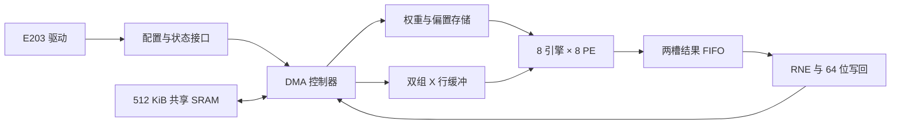

# B41 作品设计报告

工程源稿，2026-11-12。已整理架构、数值格式、驱动及冻结 RTL 验证；最终门级、覆盖审阅与功耗收尾进行中。本稿尚未作为最终提交报告冻结。动态状态见 [PROGRESS.md](../../PROGRESS.md)，逐项验收见 [ACCEPTANCE.md](../../docs/validation/xu-b41-gate-continuation-20261112/ACCEPTANCE.md)。

## 1. 设计任务与版本

本设计接入 E203，执行带偏置的前馈线性层：

`Y[r,c] = bias[c] + Σ(X[r,k] × W[k,c]), k=0..63`。

输入为 99×64，权重为 64×256，输出为 99×256。每任务产生 25,344 个结果，完成 1,622,016 次有效乘累加。12 个任务逐次更换相应层参数，各任务开始前清空任务数据和参数缓存。

| 身份 | 固定值 |
|---|---|
| 父源码 | `96fffcb2a4b2492fd2cfdecb88e164d2c67881ae` |
| E203 | `ccdac30d92ecf40f14d0b78879b8711fb0b1cdd1` |
| B41 核心 RTL SHA256 | `710b8e180652f49751769e152a3b3a9e6a35ba622fb4c3e2385dc5ffab241fcb` |
| 物理候选 SHA256 | `2d5adc613980dc21dc1f0aaa398045252911a5c67594349630ff35d78688a220` |
| 当前功能仿真副本 SHA256 | `d8e1c611016b0baa943115078ad49f6e0a147980a7e9fe13df5d3e5827da95ac` |

冻结源码、三份固件、12 层向量及校验清单位于 [strict 输入目录](../../docs/validation/xu-b41-handoff-20261112/reports/s3-y32-portable-software-design-20261110/hardware64-r1/b41-strict-input-r1/)。

## 2. 计算核心与数据流

核心由 8 个点积引擎组成，每个引擎包含 8 个 PE，共 64 PE。最多并行处理 8 行、8 个输出通道；256 个输出通道分成 32 组。最后一批按有效行数处理剩余行。权重按任务装载后供各行复用，偏置由 SRAM 预取；X 使用两组行缓冲。两槽结果 FIFO 将计算完成与 DMA 写回解耦，保存行、通道组及 signed41 结果。



DMA 在接受的请求完成响应后推进状态。验证检查请求/响应平衡、单一未决事务、源地址范围、64 位宽度及对齐、全部 Y 结果和最终写响应退休。共享 SRAM、ITCM、DTCM 与内部存储的物理宏数量、模型及活动覆盖按最终网表核对；接入核对的完整 SoC 期望为 337 个 SRAM 宏。

真实清零覆盖 W、bias、X、累加器、引擎结果、结果 FIFO、偏置缓存及 DMA 快照与所有权。当前门级物理观察器已确认一次清零包含 W=16,384、BIAS=768、X=1,024，共 18,176 次 16 位写；该观察边界为 1,027 个物理周期。RTL full12 的 clear 窗口采用其自身完整计数边界，结果单独保存。

## 3. 数值格式与误差边界

X/W 使用 signed16，bias 使用 signed40。B41 的 PE 累加、引擎结果与结果 FIFO 使用 signed41；公开 raw48 由 signed41 符号扩展得到。每次点积最多 64 项，任意部分和连同偏置满足：

```text
-618473193472 <= S <= 618475290623
signed41: [-1099511627776, 1099511627775]
```

该输入范围内累加不溢出，不增加中间截断或饱和。最终 `Y32 = RNE(S/512)`，采用最近偶数舍入。可达输出端点为 `[-1207955456, 1207959552]`，位于 signed32 范围内。

固定尺度为 X 的 `2^-11`、W 的 `2^-16`、bias/raw 的 `2^-27`，Y32 以 `code × 2^-18` 解码。软件模型名称保留 `fixed16_acc48_y32_rne9_v1`，其中精确整数运算覆盖 B41 的可达域；名称不改变公开数值契约。模型、尺度来源与参数转换入口见 [数值材料](../../docs/validation/xu-b41-handoff-20261112/reports/s3-y32-area-opt-synthesis-20261111/prelim-materials-r1/)。

冻结向量下的 RTL 与整数模型逐位一致证据已取得。组织方统一样本上的浮点 NRMSE 和正式评分按其评测入口核定，本稿不填入未经执行的精度或得分。

## 4. 驱动、存储布局与异常处理

驱动依次检查硬件 ID/能力、等待夹具就绪、清零、写入四个基址、启动、等待 DONE 并上报。任务提交及结果发布使用既有内存屏障。等待策略在离线构建时固定，正式运行中不跨任务学习参数。

| 数据 | 默认共享地址 | 传输布局 |
|---|---|---|
| X | `0xa0000000` | 32 位槽保留低 16 位 |
| W | `0xa0008000` | 行优先，每 32 位打包两个 INT16 |
| bias | `0xa0018000` | 每项一个 64 位槽，符号扩展 |
| Y | `0xa0020000` | 每项一个 32 位结果，按 64 位成对写回 |

DMA MMIO 基址为 `0x10042300`。状态、错误、任务地址和模式按冻结适配器访问。ready/ACK 共享邮箱属于开发夹具，其初始化和握手在复现说明中单列。

等待逻辑保留错误优先和有限等待。读写故障后发布一次错误，并继续确认 BUSY 释放、已接受事务响应排空；不会把尚未排空的 BUSY 当作成功。补测中三固件的读、写故障均返回 5，ERROR 只发布一次，pending、locked 与 busy 最终均为 0。

## 5. 已完成的冻结 RTL 证据

三份固件各通过 12 个正式任务、1 个 warmup、304,128 个正式输出、25,344 个 warmup 输出及 13 次真实清零。原展开保留 6 处 CPU SVA，冻结主测试台保留 52 条 fatal。三份首源 31 拍背压和六项读写故障补测通过。

下表来自原件复算结果，均为 12 个正式任务合计；warmup 另列。主窗口为 payload 与 clear 之和，任务间 gap 和软件观察区间独立记录。

| 固件 | 软件控制周期 | 主窗口周期 | ITCM 访问 | MMIO 读 | 最长上报延迟/周期 |
|---|---:|---:|---:|---:|---:|
| 紧轮询 / O2 | 429,864 | 428,916 | 151,572 | 25,248 | 33 |
| 分阶段 64 / O2 | 430,128 | 428,904 | 114,420 | 6,036 | 37 |
| 有限退避 8-256 / O2 | 430,161 | 428,905 | 115,968 | 2,412 | 45 |

这些计数用于说明等待策略的取舍。最终交付固件尚待同一物理网表、同条件全 SoC 能量结果后选择。

原件、输入清单与复算命令见 [交接材料入口](../../docs/validation/xu-b41-handoff-20261112/README.md)。本稿使用的两项复算结果及 SHA 已写入同目录 `report-data.json`。

## 6. 综合、等价与门级收尾

物理候选保存在官方 RDserver04 工作区 3。当前已核对其对 RTL 已证明双角基线的原生等价退出与日志 SHA：58,332 个比较点通过，无失败、中止或未验证；额外 PLIC 空壳实例的输出未接出，5 个未匹配实现输入引脚的范围保留在审阅记录中。

当前功能副本对该物理候选的整体 Boolean 等价已取得 58,337 个通过点，无未匹配、失败、中止或未验证。独立复位 BDD 证明覆盖 17 位；功能副本和物理网表分别保存。门级观察适配根据实际连接处理综合后未使用的别名空洞，保留完整总线比较。原 52 条主 TB 失败消息中，51 条直接保留；另一条检查独立开发夹具的 host_rsp_err 端口，PPA 顶层不含该端口，改由已核验的地址/掩码合法性范围、厂商宏物理装载及读回证据说明。DUT 固件错误退出检查保留，适用范围详见 CHECKER-MODEL-AUDIT.md。

RTL 到双角基线的接续原件也已核验：58,332 个通过点，无失败、中止或未验证。两端各有 337 个 SRAM 技术库宏；18 个参考端未匹配位为 17 个 SRAM 适配 valid_read 和 1 个 PMU 计数器最高位。冻结 RTL 与综合参考之间 162 个文件字节一致，差异限定为存储宏适配、主模块声明位置与观察接口。完整边界见随包 FORMAL-AUDIT.md。

厂商 SRAM 预检覆盖全部 1,024 地址和 4 个四态未知字，模型、测试台、工具及原生日志 SHA 均已核验。六个冻结 CPU SVA 位置在门级展开为 430 个断言，包含实际 muldiv 写回比较。门级适配增加启动阶段禁用条件，在真实外部复位已到达 CPU 后开启，覆盖正式执行、warmup 和任务；该边界在 CHECKER-MODEL-AUDIT.md 中记录。

最终网表独立展开得到 206,980 个叶实例、352 种引用，全部匹配官方 LEF；337 个宏分别为共享 SRAM 256、ITCM/DTCM 64、加速器内部 17。面积为单元与宏面积之和，未计布线、利用率或版图核心面积。

| 面积口径 | 面积 / mm² | 解释 |
|---|---:|---|
| 原生新增计价范围 | 0.508327099 | 加速器、接口、内部 17 宏及新共享端点逻辑 |
| 全 SoC 单元与宏总面积 | 3.580429529 | 包含复用 E203、共享 SRAM 及固定外设 |
| 新增预算保守上界 | 0.652901722 | 只排除 320 个复用 SRAM 宏，将全部 SoC 标准单元计入 |
| 指南新增预算 | 2.25 | 原生计价及保守上界均低于此值 |

LEF 几何独立复算与原生库单位总面积相差约 0.0964 μm²，新增范围相差约 0.0049 μm²，符合宏面积存储精度差异；完整输入 SHA 记录在官方独立面积审阅回执中。

四工况原生回执、日志、脚本及原 SDC SHA 已绑定。原约束采用 150 MHz 高频源、32.768 kHz 低频源和 10 MHz JTAG，时钟不确定度及转换时间均为 0.1 ns；普通 I/O 最大/最小延迟为 0.5/0 ns，JTAG 最大延迟 5 ns，输出负载为 0.01 库电容单位。当前采用理想时钟模式。

| 工况 | setup 最小 slack / ns | hold 最小 slack / ns | 未测试检查 |
|---|---:|---:|---:|
| SS envelope | 0 | 0.16696212 | 27,908 |
| FF envelope | 0.46407256 | 0.00027448 | 27,908 |
| SS reset_bypass | 0 | 0.16696212 | 27,914 |
| FF reset_bypass | 0.46407256 | 0.00027448 | 27,914 |

各工况共 455,015 个检查、0 个时序违例。未测试项已逐条分类：无时钟项全部为异步控制引脚的低脉宽，另有常量禁用项；两项低频去毛刺 setup、两项 PMU recovery 仍为 unknown，原报告另有不可展开时钟警告。覆盖解释与完整资格继续审阅，不能用汇总非负 slack 代替这一检查。

tight-O2 与 phased_64_fast4-O2 均已完成门级 12 正式任务、1 warmup、13 次清零和 169 组宏读检查，并通过独立复算。tight 的软件控制窗口为 429,864 周期，principal 为 428,916 周期；phased 实际门级软件控制窗口为 430,104 周期，payload 为 416,580 周期、principal 为 428,916 周期。phased 相比冻结 RTL 的软件控制少 24 周期、payload 多 12 周期，实际门级测量另列；访问与退休计数及全部功能检查一致。复算器额外的跨模型周期常量比较已改为保留差异，原断言及原始失败记录保留，说明见 [复算合同修正](../../docs/validation/xu-b41-gate-continuation-20261112/REVIEW-CONTRACT-CORRECTION.md)。R16 正串行执行最后一份 backoff，当前仍待其完整终态及三份功耗。

网表、DDC、SVF 与 DC 导出 SDC 已建立独立哈希索引；实际 STA 使用原兼容 SDC，两者角色分别保留。完整三固件门级和活动采集尚未完成，当前结果以 [原生观察记录](../../docs/validation/xu-b41-gate-continuation-20261112/OBSERVATIONS.md) 为准。单槽控制器修正事件和原始失败一并保留。

## 7. 同窗功耗、能量与交付冻结

功耗验收使用同一物理候选、库、工艺角、时钟、负载及互连条件，读取完整 SoC 的实际活动。E203、加速器、互连与 SRAM 的动态及静态功耗均计入；覆盖不足、未标注或未建模部分须继续补齐。

逐任务 payload 从首个输入/参数请求到最后 Y 写响应退休，clear、gap 与软件报告分开记录。本版测量 12 段 payload 合集的平均功耗，配对同一合集的实际总时间，统一为瓦和秒后复算 `E_task = P_payload_avg × T_payload_total / 12`。任务时间与吞吐使用原生日志的时间戳和完整周期边界。当前功耗和单任务能量尚无已验收数值，报告数据文件相应字段保持 null。

最终提交需绑定所选固件、RTL、模型、向量、网表、DDC/SVF/SDC、库、工具、功能与时序报告、活动与功耗原件及复现命令。最终面积按新增接口、加速器及内部 SRAM 预算核对，复用部分单列；150 MHz、面积及正式效率资格由完整证据和官方口径支持。

## 8. 复现输入与证据索引

三份固件的冻结映像 SHA256 如下，最终选型前均保留，不按软件访问计数预先淘汰。

| 固件 | 映像 SHA256 |
|---|---|
| tight-O2 | `2a2332d1d88610ab64fdfdefc34c0b0001da52cc68d43026e4520dbc25f0cf7d` |
| phased_64_fast4-O2 | `cb55d5f6d4aa0e7a677e85314ef9c6590a769261e9aa6efe8e54a91ef65dbafd` |
| backoff_8_256_fast4-O2 | `890b18dac8db08bd294d9c0a2073b96e323c8a34c482c329530b03bebb3b35f0` |

当前完整门级参数为 `TASKS=12, ROWS=8, WARMUP=1, MAX_CYCLES=20000000`。三份固件复用同一 simv，SHA256 为 `1845483bafd5c8fdd6e16111a5a03eefdb275c8817306978e87851f6f9da64fa`。输入、检查器、测试台和两端网表 SHA 由 full12-r15-preflight.json 绑定。重跑须另建独立输出目录并遵守原 eda.lock 和实际进程单槽检查。

官方证据根目录为 `/tmp/xu-b41-close-20261111-r1`。最终网表及四工况原件在 xu-closure-20261112-r4，整体功能副本证明在 xu-fm-functional-20261112-r1，门级原件在 xu-gate-20261112-r1；必要 payload 功耗已排队，输出根为 xu-power-payload-20261113-r3。旧 xu-power-20261112-r1 保留超时原件，不作为有效功耗。原始工程与活动留在官方服务器，随包记录保存精确路径和校验值。

计时、全 SoC 功耗、面积及交付范围依据项目提供《赛题指南》正文第 11-13 页（物理第 12-14 页），指南 SHA256 为 `b73a5414b4dcdb2cca337778a133be88705e207bec080687731d63b413ea927c`。本文将已通过的开发验证、待完成测量及需官方核定的正式评测范围分别说明。
